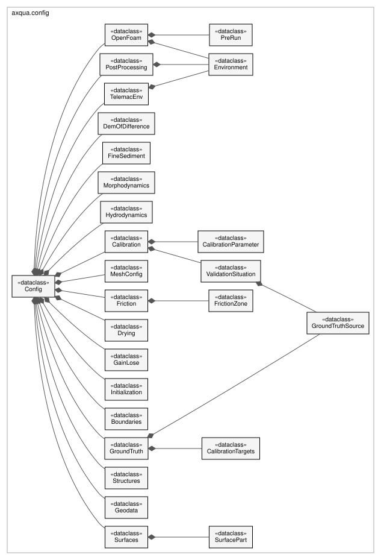
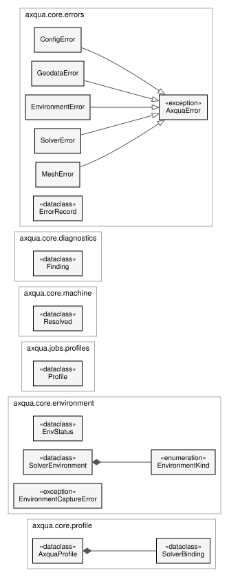

Configuration
=============

The case description and everything that locates the simulation software on a computer. ``axqua.config`` holds one data class per block of the case file. ``axqua.core.schema`` states which settings describe the river reach, which belong to one simulation code, and which describe the computer. The settings of the computer are stored in the profile (``axqua.core.profile``).

.. _uml-case:

   Classes of the case description (``axqua.config``). The class ``Config`` contains one class per block of a case file, and some blocks contain further classes, for example one class per calibration parameter.

Case description
----------------

.. automodule:: axqua.config
   :members:

Case file type
--------------

.. automodule:: axqua.core.casefile
   :members:

Classification of settings
--------------------------

.. automodule:: axqua.core.schema
   :members:

Table of settings for forms
---------------------------

.. automodule:: axqua.core.schema_meta
   :members:

Check of a case
---------------

.. automodule:: axqua.core.casecheck
   :members:

Profile of the computer
-----------------------

.. _uml-computer:

   Classes that describe the computer and the messages of aXqua. The profile (``AxquaProfile``) contains one binding per simulation code. The five error types are derived from one general error type.

.. automodule:: axqua.core.profile
   :members:

Findings of checks
------------------

.. automodule:: axqua.core.diagnostics
   :members:

Error types
-----------

.. automodule:: axqua.core.errors
   :members:

Location of the simulation software
-----------------------------------

.. automodule:: axqua.core.machine
   :members:

Environments of the simulation codes
------------------------------------

.. automodule:: axqua.core.environment
   :members:

.. automodule:: axqua.env
   :members:
