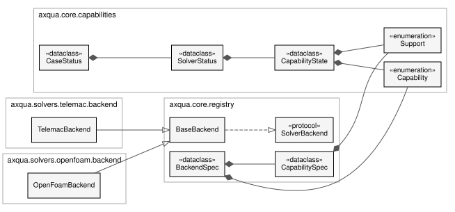

Solver-agnostic core
====================

``axqua.core`` contains everything that describes the free-surface water body and the modeling task independently of a simulation code. No module of this package imports a backend.

Geodata and rasters
-------------------

.. automodule:: axqua.core.geodata
   :members:

.. automodule:: axqua.core.raster
   :members:

Boundaries
----------

.. automodule:: axqua.core.boundaries
   :members:

Structures
----------

.. automodule:: axqua.core.structures
   :members:

Terrain from CAD surfaces
-------------------------

.. automodule:: axqua.core.surfaces
   :members:

.. automodule:: axqua.surface_stage
   :members:

SELAFIN file format
-------------------

.. automodule:: axqua.core.selafin
   :members:

Example cases
-------------

.. automodule:: axqua.core.examples
   :members:

Capabilities and backend registry
---------------------------------

.. _uml-backends:

   The simulation codes behind one interface. Both backends are derived from ``BaseBackend``, which fulfills the interface ``SolverBackend``. ``BackendSpec`` describes a backend and its capabilities without loading it.

.. automodule:: axqua.core.capabilities
   :members:

.. automodule:: axqua.core.registry
   :members:
