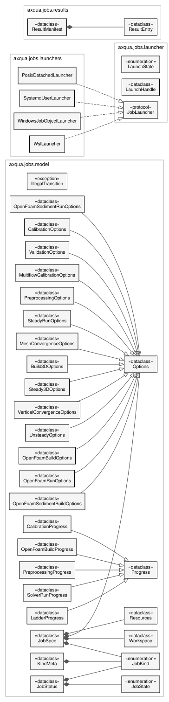

Job system
==========

``axqua.jobs`` gives a simulation a lifetime of its own. A job is a folder on disk that one process creates and another process executes. The modules ``model``, ``ids`` and ``paths`` use the Python standard library only.

.. _uml-jobs:

   Classes of a job. ``JobSpec`` is the description that is submitted, with one class of options per type of job. ``JobStatus`` is the state that the running job reports, with one class of progress per type of job. The four launchers fulfill the interface ``JobLauncher`` and detach a job on Linux, on Windows and in the Windows Subsystem for Linux.

Job description and storage
---------------------------

.. automodule:: axqua.jobs.model
   :members:

.. automodule:: axqua.jobs.ids
   :members:

.. automodule:: axqua.jobs.paths
   :members:

.. automodule:: axqua.jobs.store
   :members:

.. automodule:: axqua.jobs.lock
   :members:

.. automodule:: axqua.jobs.index
   :members:

.. automodule:: axqua.jobs.results
   :members:

Processes and state reconciliation
----------------------------------

.. automodule:: axqua.jobs.procs
   :members:

.. automodule:: axqua.jobs.reaper
   :members:

Solver profiles
---------------

.. automodule:: axqua.jobs.profiles
   :members:

Progress events and logs
------------------------

.. automodule:: axqua.jobs.events
   :members:

.. automodule:: axqua.jobs.logs
   :members:

.. automodule:: axqua.jobs.interaction
   :members:

Submission and execution
------------------------

.. automodule:: axqua.jobs.submit
   :members:

.. automodule:: axqua.jobs.executor
   :members:

Detached launchers
------------------

.. automodule:: axqua.jobs.launcher
   :members:

.. automodule:: axqua.jobs.launchers.systemd
   :members:

.. automodule:: axqua.jobs.launchers.posix
   :members:

.. automodule:: axqua.jobs.launchers.windows
   :members:

.. automodule:: axqua.jobs.launchers.wsl
   :members:
