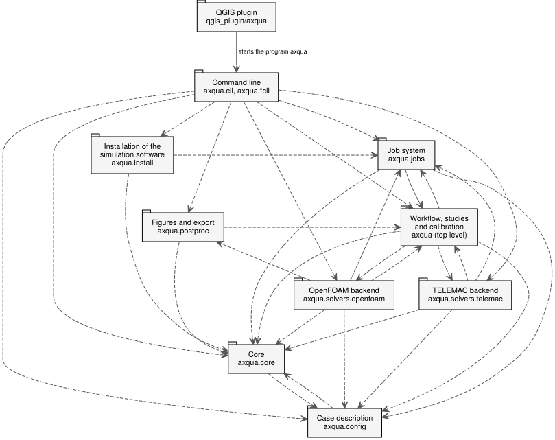

General structure & UML
=======================

aXqua consists of three parts that can be used independently of each other: a **library** that builds and evaluates models, a **job system** that runs simulations as independent processes, and the **QGIS plugin** as the user interface.

   Packages of aXqua in the notation of the Unified Modeling Language (UML). A dashed arrow points from a package to a package that it uses. The plugin is connected by a solid arrow, because it does not use the library as program code: it starts the program ``axqua`` and reads the files that the program writes.

The diagram shows the three design rules that are stated below: no arrow leads from the core to a backend, none connects the two backends, and the plugin reaches the library through the command line only. The diagrams of this section are generated from the source code with the script ``scripts/build_uml.py`` and therefore show the code as it is.

Class diagrams of the central data structures are part of the pages that document them:

* the case description, with one class per block of a case file (:ref:`uml-case`);
* the profile of the computer and the messages of the checks (:ref:`uml-computer`);
* the simulation codes behind one interface, and their capabilities (:ref:`uml-backends`);
* a job, from its submission to its result (:ref:`uml-jobs`).

The class diagrams use three types of connections. An arrow with a hollow triangle points from a specialized class to the general class from which it is derived. A line with a filled diamond connects a class with its components, with the diamond at the class that contains them. A dashed arrow with a hollow triangle points from a class to an interface that the class fulfills. The label above a class name, for example ``«dataclass»`` or ``«enumeration»``, states the type of the class.

Design rules
------------

Three rules determine the structure. Each of them is enforced by an automated test that reads the source code.

#. **The core does not depend on a simulation code.** ``axqua.core`` describes the river reach and the modeling task. The backends in ``axqua.solvers`` depend on the core, never the reverse. A further simulation code can therefore be added without changing the core.
#. **The backends do not depend on each other.** The TELEMAC backend and the OpenFOAM backend do not import each other. Steps that involve both codes, such as the TELEMAC warm-up of an OpenFOAM model, are coordinated one level above (``axqua.prerun``, ``axqua.workflow``).
#. **The plugin does not import the library.** QGIS has its own Python installation, whereas the library requires several geospatial packages and the environment of a simulation code. The plugin therefore calls the program ``axqua`` as a separate process and exchanges only small pieces of information with it: a job ID, a state, a file path. Result data never passes through the plugin. QGIS opens the result files itself.

A consequence of the third rule is that a simulation does not depend on QGIS being open. The plugin submits a job and displays its state, but the job belongs to the operating system.

Packages
--------

.. list-table::
   :header-rows: 1
   :widths: 30 70

   * - Package
     - Content
   * - ``axqua.config``
     - The case description as Python data classes, with reading and writing of the case file (:doc:`configuration`).
   * - ``axqua.core``
     - Geodata, rasters, boundaries, structures, the SELAFIN file format, capabilities, the registry of backends, error types and the environments of the simulation codes (:doc:`core`).
   * - ``axqua.solvers.telemac``
     - Mesh generation, boundary conditions, steering files, runs and evaluation for TELEMAC (:doc:`telemac`).
   * - ``axqua.solvers.openfoam``
     - Mesh generation, initial fields, dictionaries, runs and evaluation for OpenFOAM (:doc:`openfoam`).
   * - ``axqua`` (top level)
     - Steps that are independent of the simulation code or involve both codes: terrain processing, measurements, studies and calibration (:doc:`workflow`).
   * - ``axqua.jobs``
     - Identity, storage, execution and detaching of jobs (:doc:`jobs`).
   * - ``axqua.postproc``
     - Figures from results (:doc:`postprocessing`).
   * - ``qgis_plugin/axqua``
     - The QGIS plugin (:doc:`plugin`).

The backends are registered through the entry point group ``axqua.solvers`` of the Python package. A further simulation code can be provided as a separate Python package that registers itself in this group.

Capabilities
------------

Each backend declares which types of simulation it supports, for example a steady 2D simulation or a mesh convergence study. For a given case, aXqua reports each capability on three independent levels:

* ``implemented``: the backend supports the capability (``yes``, ``no``, or ``n/a`` when the capability does not exist for the code);
* ``configured``: the case file requests it;
* ``built`` and ``run``: the input files and the result files exist.

The command ``axqua case-status <case-file> --json`` returns this information. The plugin uses it to decide which functions it offers for a case.

Licenses
--------

The library is distributed under the BSD 3-Clause License. The QGIS plugin is distributed under the GNU General Public License, version 2 or later, because it uses the programming interface of QGIS.
