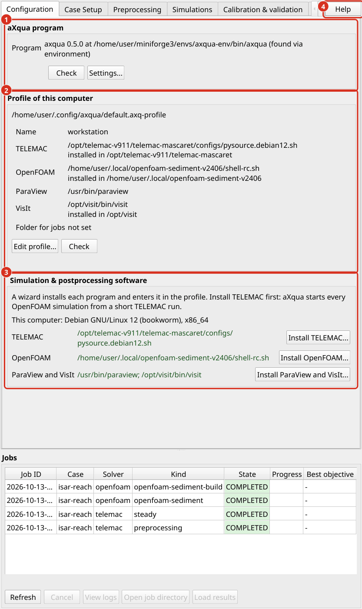
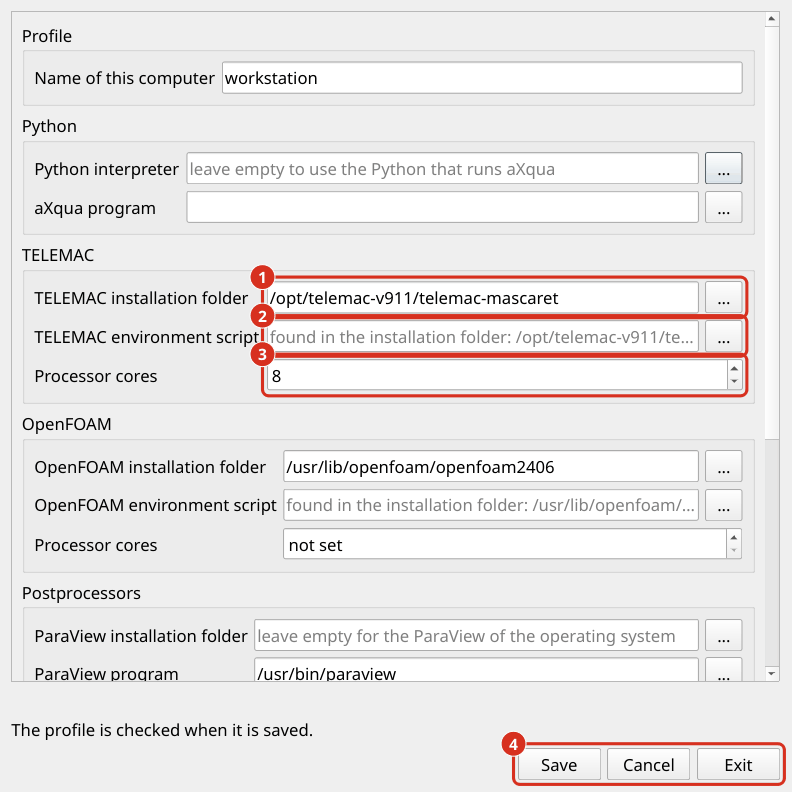

.. _help-configuration:

Plugin setup
============

The plugin setup contains everything that describes the **computer** and not the simulation project, that is, where Python and the simulation software are installed, and where simulations will be written. These **settings are made once per computer**. They are kept apart from the description of a reach (:doc:`../usage/case-setup`), so that a case can be copied to another computer without changes.

.. _plugin-profile:

Plugin profile
--------------

All settings of a computer are stored in one file, the **profile**. Its name ends with ``.axq-profile``. The default profile is the file ``default.axq-profile`` in the aXqua configuration folder of the user (``~/.config/axqua/`` on Linux). Each user account of a computer has its own profile.

**In the plugin.** The *Configuration* tab shows the profile of this computer. On a computer without a profile, click *Create profile...*: aXqua searches for Python, TELEMAC, OpenFOAM, ParaView and VisIt and opens the profile editor with what it found. With a profile, the button reads *Edit profile...*. Every path in the editor has a button that opens a file dialog, so that nothing has to be typed. The editor has three buttons at the bottom right:

* *Save* writes the profile and checks it. The window stays open and shows what the check found.
* *Cancel* discards the changes since the last save and closes the window.
* *Exit* closes the window and asks first if there are changes that were not saved.

   The *Configuration* tab. (1) The ``axqua`` program that the plugin calls, with *Settings...* to select it. (2) The profile of the computer with what it names for each program, *Edit profile...* and *Check*. (3) The box *Simulation & postprocessing software*: the installation wizards, with each program that was found in dark green; a program that was not found is named in bold dark purple. (4) *Help* opens the online documentation at the section of the tab that is showing.

Each program has two rows in the editor: its **installation folder**, and below it the file that aXqua runs. For TELEMAC and OpenFOAM this file is the environment script (:ref:`solver-bindings`), and for ParaView and VisIt it is the program file. Selecting the installation folder is sufficient: aXqua searches the folder and enters the file in the row below, where it can still be changed. If a folder contains several environment scripts, the editor lists them, and one of them has to be selected in the row below.

   The profile editor. (1) The installation folder of a program, selected with the button next to it. (2) The environment script, here found by aXqua in the installation folder. (3) The number of processor cores for a simulation. (4) *Save*, *Cancel* and *Exit*.

A program that is installed with one of the installation wizards is entered in the profile by the wizard, together with its installation folder (:doc:`simulation-software`). The editor is needed for a program that was installed by other means, and for the remaining settings.

The check never prevents saving. It marks each entry that is not in order with a triangle, orange for a warning and dark red for an error. A click on a triangle opens the message with its remedy and a button that opens this documentation at the explanation of the message (:doc:`../troubleshooting/warnings`, :doc:`../troubleshooting/errors`). The button *Check* on the *Configuration* tab repeats the check at any time.

**In a terminal.** To create the profile, let aXqua detect what is installed on the computer:

.. code-block:: text

   axqua profile init

The command searches for Python, TELEMAC, OpenFOAM, ParaView and VisIt, writes what it finds into the default profile and prints the location of the file. It never overwrites an existing profile. Afterwards, verify the profile:

.. code-block:: text

   axqua profile check

The check reports everything that is missing or wrong, each item with the entry of the profile that it concerns. It also enters the environment of TELEMAC and of OpenFOAM, to verify that the codes can actually be started, which takes a few seconds. ``axqua profile show`` prints the profile in use.

The profile is a text file in YAML format and can be completed with a text editor:

.. code-block:: yaml

   schema_version: 1
   name: workstation
   python:
     executable: /home/user/miniforge3/envs/axqua-env/bin/python
     axqua: /home/user/miniforge3/envs/axqua-env/bin/axqua
   installations:
     telemac: /home/user/opt/telemac-mascaret
     openfoam: /usr/lib/openfoam/openfoam2406
     visit: /home/user/opt/visit
   solvers:
     telemac:
       setup_script: /home/user/opt/telemac-mascaret/configs/pysource.debian12.sh
       mpi_processes: 12
     openfoam:
       setup_script: /usr/lib/openfoam/openfoam2406/etc/bashrc
       mpi_processes: 16
   postprocessors:
     paraview: /usr/bin/paraview
     visit: /home/user/opt/visit/bin/visit
   jobs:
     root: /scratch/axqua-jobs
   display:
     min_depth: 0.01
     velocity_cap: 5.0

.. list-table::
   :header-rows: 1
   :widths: 24 76

   * - Block
     - Content
   * - ``python``
     - The Python interpreter in which aXqua is installed, and the ``axqua`` program that the plugin calls.
   * - ``installations``
     - The folder in which each program is installed on this computer, with one entry each for ``telemac``, ``openfoam``, ``paraview`` and ``visit``. If a folder is given and the entry of the program under ``solvers`` or ``postprocessors`` is missing, aXqua uses the environment script or the program file that it finds in the folder. A profile that names the four folders is therefore complete. An entry under ``solvers`` or ``postprocessors`` takes precedence over the folder. A program that is a package of the operating system, such as ``/usr/bin/paraview``, needs no folder.
   * - ``solvers``
     - One binding per simulation code (:ref:`solver-bindings`).
   * - ``postprocessors``
     - The programs for three-dimensional figures (:doc:`postprocessors`).
   * - ``jobs``
     - Where and how simulations are run (:ref:`plugin-job-execution`).
   * - ``display``
     - Two values for maps in QGIS. ``min_depth`` is the minimum water depth in meters. Shallower water is drawn transparent, because a water film of a few millimeters stands between the roughness elements of the bed and does not flow. ``velocity_cap`` is the upper limit of the velocity color scale in m/s. Higher depth-averaged velocities typically occur in almost dry cells at the edge of the water and would otherwise flatten the color scale of the entire map.

To use another profile than the default one, for example on a computing cluster, set the environment variable ``AXQUA_PROFILE`` to its path, or pass ``--profile <file>`` when a job is submitted.

**Updates.** The profile is stored in the configuration folder of the user account, outside of the plugin and outside of the aXqua program. An update or a new installation of the plugin, of aXqua or of QGIS therefore neither changes nor removes it, and the new version reads the existing profile. The plugin itself stores only the path of the ``axqua`` program, in the settings of QGIS, which an update of the plugin also keeps. An entry of the profile that the installed version of aXqua does not know, for example because a newer version wrote it, stays in the file and is reported as a warning. A profile that cannot be read at all is never overwritten: if a new profile is saved in its place, aXqua keeps the previous file in the same folder under a name that ends with ``.bak``.

.. _solver-bindings:

Define solver bindings
----------------------

A solver binding tells aXqua how to reach one simulation code. Its central entry is ``setup_script``, the environment script of the installation (:doc:`simulation-software`). The folder of the installation is stored separately, under ``installations`` (:ref:`plugin-profile`). If a profile names the installation folder of a code and no ``setup_script``, aXqua uses the environment script that it finds in the folder, and the remaining entries of the binding are optional as before.

.. list-table::
   :header-rows: 1
   :widths: 24 76

   * - Entry
     - Meaning
   * - ``setup_script``
     - The environment script of the code: ``pysource.<system>.sh`` for TELEMAC and ``etc/bashrc`` for OpenFOAM.
   * - ``mpi_processes``
     - Number of processor cores that a simulation uses on this computer. Without this entry, the number in the case file applies. Use the number of physical cores, not of logical cores.
   * - ``environment``
     - ``posix`` (Linux and macOS, the default there), ``windows`` (an installation directly on Windows) or ``wsl`` (an installation in the Windows Subsystem for Linux).
   * - ``distro``
     - Name of the Linux distribution, for ``environment: wsl`` only. The ``setup_script`` is then a path inside that distribution.
   * - ``mpi_launcher``
     - The program that starts parallel runs, if it is not ``mpirun`` (``mpiexec`` on Windows).

A code without a binding cannot be used on the computer. This is no error: a computer on which only TELEMAC is installed simply has no ``openfoam`` entry.

A profile takes precedence over machine settings that a case file may still contain. Three sources take precedence over the profile, for special situations: the environment variables ``AXQUA_TELEMAC_PYSOURCE`` and ``AXQUA_OPENFOAM_BASHRC``, and a file ``solvers.local.yml`` next to a case file, which binds another installation for this one case.

Installations that were set up with an earlier version of aXqua keep working without a profile. Their settings in the files ``solvers.yml`` and ``profiles.yml`` of the configuration folder are still read. ``axqua profile init`` takes over the bindings of ``solvers.yml``.

.. _plugin-job-execution:

Job execution
-------------

Every simulation runs as a **job**: an independent process with its own folder, which continues when QGIS is closed. Two entries of the ``jobs`` block control how jobs are run:

* ``root`` is the folder in which the job folders are created. Select a drive with sufficient free space, because the results of a single simulation can reach tens of gigabytes. Without this entry, jobs are written to the aXqua data folder of the user.
* ``launcher`` is the method that detaches a job from QGIS. The default ``auto`` selects a suitable method for the operating system and rarely needs to be changed.

:doc:`../automation/batch-headless` describes jobs in detail.
