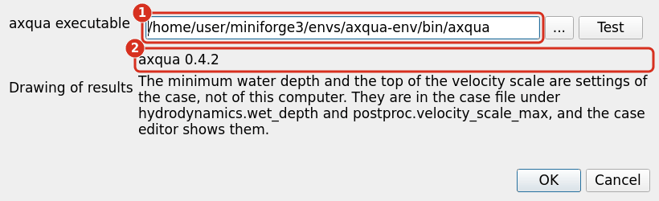
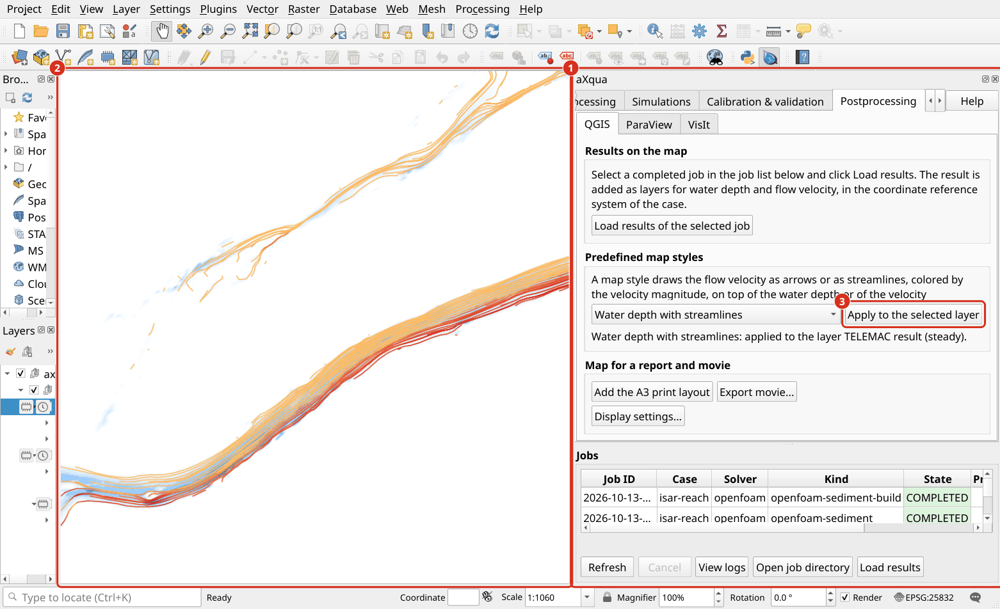

QGIS plugin
===========

The plugin is the user interface. It computes nothing: every task goes to the **aXqua program**, a separate process next to QGIS.

* Both are required. The plugin alone has nothing to pass work to.
* Install in the order below. The plugin only looks for the program when a task is started, so it may be installed second.

Install QGIS
------------

* Download from `qgis.org <https://qgis.org/download/>`_.
* **QGIS 3.44 or newer** is required, QGIS 4 included.

Install the plugin
------------------

* *Plugins > Manage and Install Plugins*.
* In the *Settings* tab, tick *Show also experimental plugins*.
* Search for **aXqua**, click *Install Plugin*.

Until the plugin is in the QGIS plugin repository, take the ``.zip`` from the `releases page <https://github.com/sschwindt/aXqua/releases>`_ and use *Install from ZIP*.

Install the aXqua program
-------------------------

Requires Python 3.10 or newer and a geospatial stack (``numpy``, ``pandas``, ``scipy``, ``pyyaml``, ``pyproj``, ``shapely``, ``geopandas``, ``rasterio``, ``gmsh``, ``openpyxl``, ``matplotlib``). The tested route is a separate environment from `Miniforge <https://github.com/conda-forge/miniforge>`_:

.. code-block:: bash

   git clone https://github.com/sschwindt/aXqua.git
   cd aXqua
   mamba env create -f environment.yml
   mamba activate axqua-env
   pip install .
   axqua --version

``axqua --version`` printing a version confirms the installation.

* **Bayesian calibration** needs one more package: ``pip install ".[calibration]"``.
* If pip finds no matching ``hydrobayescal``, it is not on PyPI yet. Install it from source, without a version tag, so that the newest is taken:

  .. code-block:: bash

     pip install "git+https://github.com/Ecohydraulics/hydrobayescal.git"

* aXqua can also go into the Python that ships with QGIS, if the packages above install there. The separate environment is the tested route and keeps QGIS and aXqua updatable independently.

.. _find-the-axqua-path:

Find the path of the installed program
--------------------------------------

The plugin needs the full path of the ``axqua`` program, not the folder that holds it. Activate the environment and ask the system where the program is:

.. code-block:: bash

   mamba activate axqua-env
   which axqua          # Linux, macOS
   where axqua          # Windows

What it prints is the path to enter in the plugin:

=========  ====================================================================
Linux      ``/home/<user>/miniforge3/envs/axqua-env/bin/axqua``
macOS      ``/Users/<user>/miniforge3/envs/axqua-env/bin/axqua``
Windows    ``C:\Users\<user>\miniforge3\envs\axqua-env\Scripts\axqua.exe``
=========  ====================================================================

* Nothing printed: the environment is not active, or ``pip install .`` did not run in it.
* To find an environment without activating it, ``mamba env list`` prints every environment with its folder. The program is then ``<folder>/bin/axqua`` (Linux, macOS) or ``<folder>\Scripts\axqua.exe`` (Windows).

Connect the plugin to the aXqua program
---------------------------------------

* Open the aXqua panel from the toolbar and click *Check* on the *Configuration* tab.
* The plugin looks in three places, in this order: the path in *aXqua > Settings*, the variable ``AXQUA_EXE``, the system search path.
* **Found**: the panel reports the version and where it came from. Nothing else to do.
* **Not found**: enter the path from :ref:`find-the-axqua-path` in *Settings*, then click *Test*.

*Test* reports the version that the path answers with, so a wrong path is caught here and not when a simulation is started.

   The dialog *aXqua > Settings* with a correctly entered path. (1) The full path of the program, ending in ``envs/axqua-env/bin/axqua``; the button *...* opens a file dialog instead. (2) *Test* reports the version that this path answers with. How results are drawn is not set here: it belongs to the case (``hydrodynamics.wet_depth`` and ``postproc.velocity_scale_max``).

**The panel.** The tabs follow the workflow: *Configuration*, *Case Setup*, *Preprocessing*, *Hydraulic simulation*, *Mesh convergence*, *Morphodynamic simulation*, *Calibration & validation*, *Postprocessing*, *Batch-processing*. *Help* at the top right opens this documentation at the section of the tab that is showing. The job list below the tabs is visible from every tab.

   The aXqua panel in QGIS. (1) The panel with its tabs, the button *Help* and the job list. (2) The map of QGIS, here with the result of a steady simulation in the map style *Water depth with streamlines* (:ref:`help-postprocessing-qgis`). (3) Every function of aXqua is a button on one of the tabs.
