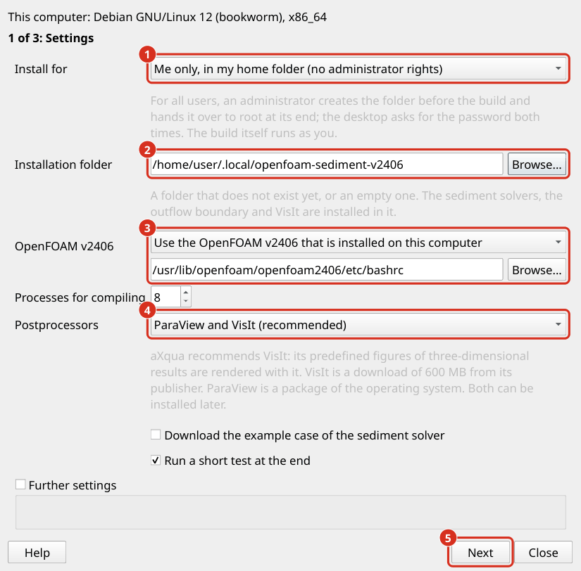

Simulation Software
===================

aXqua prepares and starts simulations, but the numerical codes are separate software that must be installed additionally. The plugin installs them with one wizard per program. Install TELEMAC first. OpenFOAM (including postprocessors) is optional and builds on TELEMAC.

.. note::
   On Windows, TELEMAC and OpenFOAM run in the Windows Subsystem for Linux (WSL 2). The wizards of a QGIS that runs in Windows do not install into WSL. Install a distribution with ``wsl --install -d Ubuntu-24.04`` in a **PowerShell** (similar to Linux **terminal**) with administrator rights, install aXqua inside the distribution, and run ``axqua install start telemac`` in its terminal. Select an installation folder in the Linux file system: a build in a Windows folder (``/mnt/c/...``) is slower by an order of magnitude. This route has not yet been tested on a real Windows installation.

Installation wizards (short version)
------------------------------------

The wizards are opened on the **Configuration** tab, in the box **Simulation & postprocessing software** showing the operating system that the aXqua *Check* button detected.

.. note::
    If the aXqua program *Check* identified existing TELEMAC, OpenFOAM or postprocessor software installation, the box states for each program where it is installed or that it was not found.

To start the installation of each software, click **Install <software-name>...** and an installation wizard opens. Each wizard has three intuitive tabs in which users make choices according to their needs:

#. **Settings:** Installation folder and installer choices. Every folder and file is selected in a dialog, so nothing has to be typed. Details on software-specific settings are provided below on this page.
#. **Check:** aXqua examines the computer and lists the commands that it is about to run, expected duration, and everything that is not in order. An orange triangle marks a warning, with which the installation can be started. A dark red triangle marks an error. To proceed with the installation:
    * Complete the prompts in **the dialog frame that shows required user actions to be executed in terminal.**
    * Then click on the **INSTALL button on the bottom-left.**
#. **Installation:** Run and show the current step and the end of the installation log. The installation is a process of its own: the wizard and QGIS can be closed while it runs. The *Configuration* tab reports that an installation is running, and the wizard shows it again when it is reopened.

The tabs can be visited in any order, and *Back* and *Next* at the bottom of the wizard walk through them. Changed settings are checked again when the *Check* tab is opened.

At the end, aXqua verifies that the installer produced the program, enters the program and its installation folder in the computer profile (:ref:`plugin-profile`), and starts it once. After a successful installation, the button *Cancel the installation* turns dark gray-green and reads *Installation complete*; a click closes the wizard. No further configuration is required.

In the box **Simulation & postprocessing software**, the path of a program that was found is written in dark green, and *Not found on this computer.* in bold dark purple. Clicking *Install <software-name>...* for a program that is installed already first asks *Software already installed. Continue with re-installation?* *No* returns to the *Configuration* tab. *Yes* opens the wizard, whose *Settings* tab then starts with the setting *Existing installation*:

* *Remove the existing installation and install it again in its folder* deletes the earlier installation before the new one is built. aXqua removes only an installation that one of its installers made: the subfolder ``telemac-mascaret`` of TELEMAC, a folder of the OpenFOAM installer, or the VisIt folders of the postprocessors.
* *Continue in the existing folder* keeps what is downloaded and built and repeats the remaining steps. The OpenFOAM installer refuses to continue a folder that another version of it started; the *Check* tab says so before anything runs.
* *Install it again in a new folder* leaves the existing installation untouched.

.. note::
    The wizards run installer scripts of the `installer repository <https://github.com/Ecohydraulics/numerical-software-installers>`_, in the version with which this version of aXqua was tested. The OpenFOAM installer of that repository is shipped with aXqua, together with the source code of Olsen's sediment solvers, so that installing OpenFOAM does not depend on the website where Nils Reidar Olsen publishes them (the repo was unreachable with the error HTTP 502 in October 2026). The scripts exist for Debian 12, Ubuntu 22.04, Ubuntu 24.04 and Linux Mint 22. For another system that is built on one of these, select the base system under *Further settings* on the *Settings* tab.

User rights
-----------

**System packages and administrator rights:** Compilers and numerical libraries are packages of the operating system, and installing them is the only step that requires administrator rights. The *Check* tab states how many of the required packages are missing and shows the one command that installs them in a box below the heading **REQUIRED USER ACTIONS in TERMINAL:**, both in dark purple. The command can be run in two ways:

* *Run fixes* runs the command. On a desktop, the password dialog of the desktop asks for the password; otherwise a terminal window opens and asks for it. The password does not pass through the plugin. aXqua then checks the computer again and repeats the fixes as long as they make progress.
* *Copy the command* places the command in the clipboard, to be pasted into a terminal. On a computer that is managed by an institution, send the command to the administrator.

If the fixes do not solve the problem, for instance because the same packages remain missing, the button *Report issue* appears. It opens a window with a report of the computer, the command, and what the check found, in which your home folder is written as ``~``. The report can be read and changed before it is sent: *Open on GitHub* opens a new issue in the `issue tracker <https://github.com/sschwindt/aXqua/issues>`_ (a free GitHub account is required), *Send by e-mail* opens the mail program with the report (no account is required), and *Copy report* places it in the clipboard. A failed installation offers the same button on the *Installation* tab, with the end of the installation log in the report.

**For me only, or for all users:** The first setting of each wizard, *Install for*, decides who can use the program:

* *Me only* (the default) installs into a folder in your home folder: ``~/opt`` for TELEMAC, ``~/.local/openfoam-sediment-v2406`` for OpenFOAM, and ``~/.local/axqua-postprocessors`` for VisIt. The installation itself requires no administrator rights; only missing system packages do, as described above.
* *All users of this computer* installs into a folder below ``/opt``: ``/opt/telemac``, ``/opt/openfoam-sediment-v2406``, or ``/opt/axqua-postprocessors``. The build still runs under your user account, because the installers refuse to compile as the administrator. The password of an administrator is asked twice: before the build, to create the folder for you, and at its end, to hand the folder over to the administrator, readable for every user and writable for nobody else. The aXqua of every other user finds the programs in these folders without any entry in their profile. Changing the folder later, for example to add the example cases of TELEMAC, again requires an administrator.

On the desktop, the password dialog of the desktop asks for the password. In a terminal, ``axqua install start openfoam --for-all-users --foreground`` lets ``sudo`` ask for it; a detached installation without a desktop cannot ask and stops before it builds anything.

Click *Check again* afterwards. The installation itself runs with the rights of the ordinary user and writes into the installation folder only.

**From a terminal.** Each wizard corresponds to one command, ``axqua install``, which does the same without QGIS (:doc:`../automation/terminal-syntax`).

.. _install-telemac:

TELEMAC
-------

`TELEMAC <http://www.opentelemac.org/>`_ solves the depth-averaged (2D) and 3D flows, coupled with a large variety of modules for purposes like sediment transport (Gaia), water quality analysis (WAQTEL), wave propagation (ARTEMIS and TOMAWAC). Its sediment transport module GAIA is part of the same installation. aXqua is developed and tested with TELEMAC v9.1.1.

Click **Install TELEMAC...** on the **Configuration** tab. The wizard is available on Debian 12, Ubuntu 24.04 and Linux Mint 22. Its *Settings* tab has four settings besides *Install for*:

.. list-table::
   :header-rows: 1
   :widths: 26 74

   * - Setting
     - Meaning
   * - Installation folder
     - TELEMAC is installed in the subfolder ``telemac-mascaret`` of this folder. The default is the folder ``opt`` in the home folder. If the subfolder exists already, the installer keeps its source code and builds TELEMAC in it again.
   * - TELEMAC version
     - Leave the field empty for v9.1.1.
   * - Example cases of TELEMAC
     - TELEMAC is distributed with about 830 example cases. Their steering files are always installed with the source code. The setting selects how many of their large files are downloaded in addition. *Input files of examples only* (the default) downloads what a run of an example reads, which is mainly its mesh: about 360 files and 460 MB. *Everything* also downloads the reference results, with which TELEMAC validates itself, and the manuals: 1,500 files and 1.65 GB, which takes about one hour. *Steering files only* downloads none of the large example files. aXqua itself requires none of these files.
   * - SALOME archive
     - Optional. A downloaded archive of SALOME, which is then installed next to TELEMAC. aXqua uses `Gmsh <https://gmsh.info/>`_ (Geuzaine and Remacle 2009) and does not require SALOME, because it generates the mesh and the input files itself.

The installation downloads the source code of TELEMAC and compiles it for parallel computation with the system libraries MPI, MUMPS, METIS and MED. It requires about 2.5 GB of free space with the input files of the example cases and about 5 GB with everything. On a workstation with 32 processor cores, the installation with the default setting took 11 minutes, of which the input files of the example cases took 7 minutes.

The large files of the example cases are stored separately from the source code, and the download server delivers them one at a time when all of them are requested. For this reason, the default setting requests only the files that a run reads. aXqua determines these files from TELEMAC itself: the keyword dictionaries of TELEMAC state for every file whether a run reads or writes it. The missing files can be downloaded at any time afterwards: ``axqua install telemac-examples <folder>`` downloads the input files that are still missing, and ``git lfs pull`` in the folder ``telemac-mascaret`` downloads everything.

The result is the file ``telemac-mascaret/configs/pysource.<system>.sh`` in the installation folder. This file is the **environment script** of TELEMAC: it sets all variables that TELEMAC requires. The wizard enters it in the profile as the solver binding of TELEMAC (:ref:`solver-bindings`).

If the installation fails, the wizard shows the last lines of the installation log and the location of the complete log. After the cause is corrected, start the wizard again with the same folder. The installer continues with what is already downloaded.

A manual installation is described in the `TELEMAC installation tutorial <https://hydro-informatics.com/get-started/install-telemac-autoinstaller.html>`_. Enter the environment script of a manual installation in the profile editor.

.. _install-openfoam:

OpenFOAM
--------

`OpenFOAM <https://www.openfoam.com/>`_ enables a better resolution of flow in 3D, which is particularly important for the simulation of hydraulic structures such as weirs or vertical slot fishways. aXqua is designed to function with **OpenFOAM v2406** as distributed by OpenCFD (``openfoam.com``), which is compatible with the sediment transport solvers **sediDriftFoam** (`Olsen et al. 2023 <https://doi.org/10.2166/hydro.2023.309>`_) and **sediDriftFoam2** (`Olsen 2025 <https://doi.org/10.2166/hydro.2025.059>`_). The releases of the OpenFOAM Foundation (``openfoam.org``) use different file formats and do not read the input files that aXqua writes.

.. important::

   Install TELEMAC also when OpenFOAM is the code of interest. aXqua starts every OpenFOAM simulation from the result of a short TELEMAC run, which is called the warm-up (:ref:`warm-up-concept`). Without it, OpenFOAM has to fill a dry riverbed with water on its own, which multiplies the computing time.

Click *Install OpenFOAM...* on the *Configuration* tab. The wizard is available on Debian 12, Ubuntu 22.04, Ubuntu 24.04 and Linux Mint 22, on computers with an x86-64 processor. It installs the following components into one folder:

* **OpenFOAM v2406**, unless an installation of this version exists already (see the settings below).
* The sediment transport solvers **sediDriftFoam** (`Olsen et al. 2023 <https://doi.org/10.2166/hydro.2023.309>`_) and **sediDriftFoam2** (`Olsen 2025 <https://doi.org/10.2166/hydro.2025.059>`_), and a variant of the latter with a stage-discharge outflow, ``sediDriftFoam2Rating``, which the installer marks as not validated.
* The **stage-discharge outflow boundary** of the Federal Waterways Engineering and Research Institute (BAW) for the solver ``interFoam`` (`Thorenz 2024 <https://doi.org/10.3929/ethz-b-000675949>`_).
* The postprocessors **ParaView** and **VisIt** (:ref:`help-postprocessors`), unless they are deselected.

.. list-table::
   :header-rows: 1
   :widths: 26 74

   * - Setting
     - Meaning
   * - Installation folder
     - A folder that does not exist yet, or an empty one. The installer installs into a new folder or continues an installation of its own, and refuses any other folder.
   * - OpenFOAM v2406
     - *Use the OpenFOAM v2406 that is installed on this computer* builds the solvers on an existing installation, which takes a few minutes. aXqua enters the installation that it found. Select the file ``etc/bashrc`` of another one with *Browse...*. *Compile OpenFOAM v2406 from its source code* is the choice for a computer without OpenFOAM. It takes several hours and requires about 20 GB of free space.
   * - Processes for compiling
     - The number of processor cores used for compiling. Each process requires about 2 GB of memory.
   * - Postprocessors
     - *ParaView and VisIt* is the default and the recommended choice, because aXqua renders its predefined three-dimensional figures with VisIt. *ParaView only* leaves VisIt out, which saves a download of 600 MB. *None* installs neither program, for a computer on which both are installed already. A program that was left out can be installed at any time afterwards (:ref:`help-postprocessors`).
   * - Download the example case of the sediment solver
     - Adds the example case that is published with sediDriftFoam.
   * - Run a short test at the end
     - Runs ``interFoam`` for a few time steps with the outflow boundary of the BAW, which verifies that the compiled library can be loaded.

   The *Settings* tab of the OpenFOAM wizard. (1) For whom the program is installed: for you alone, or for all users of the computer. (2) The installation folder. (3) The existing OpenFOAM v2406 on which the solvers are built, or the choice to compile it. (4) The selection of the postprocessors. (5) *Next* leads to the tab *Check*.

A packaged OpenFOAM v2406 saves the hours of compilation. OpenCFD provides packages for Debian and Ubuntu. An administrator installs them according to the `installation instructions of OpenCFD <https://develop.openfoam.com/Development/openfoam/-/wikis/precompiled/debian>`_, which creates the file ``/usr/lib/openfoam/openfoam2406/etc/bashrc``. The wizard finds this installation by itself.

The result is the file ``shell-rc.sh`` in the installation folder. It is the **environment script** of this installation: it loads OpenFOAM v2406 and adds the compiled solvers and the boundary library. The wizard enters it in the profile as the solver binding of OpenFOAM, and enters the selected postprocessors. No existing OpenFOAM installation and no startup file of the user account is changed.

.. note::

   aXqua sets up simulations with the sediment transport solver sediDriftFoam2, for fine sediment over a bed that stays in place (*Simulations > Morphodynamics* with the simulation program *OpenFOAM*, :ref:`help-morphodynamics-openfoam`), and OpenFOAM simulations with the stage-discharge outflow boundary of the BAW (``openfoam.outflow_boundary: rating-curve``, :ref:`preprocessing-openfoam-choices`). The variant ``sediDriftFoam2Rating``, which moves the bed and the water surface, is installed but not set up by aXqua, because aXqua keeps the bed and the surface of a sediment simulation in place.

.. rubric:: References

Geuzaine, C., Remacle, J.-F., 2009. Gmsh: A 3-D finite element mesh generator with built-in pre- and post-processing facilities. International Journal for Numerical Methods in Engineering 79, 1309–1331. https://doi.org/10.1002/nme.2579
