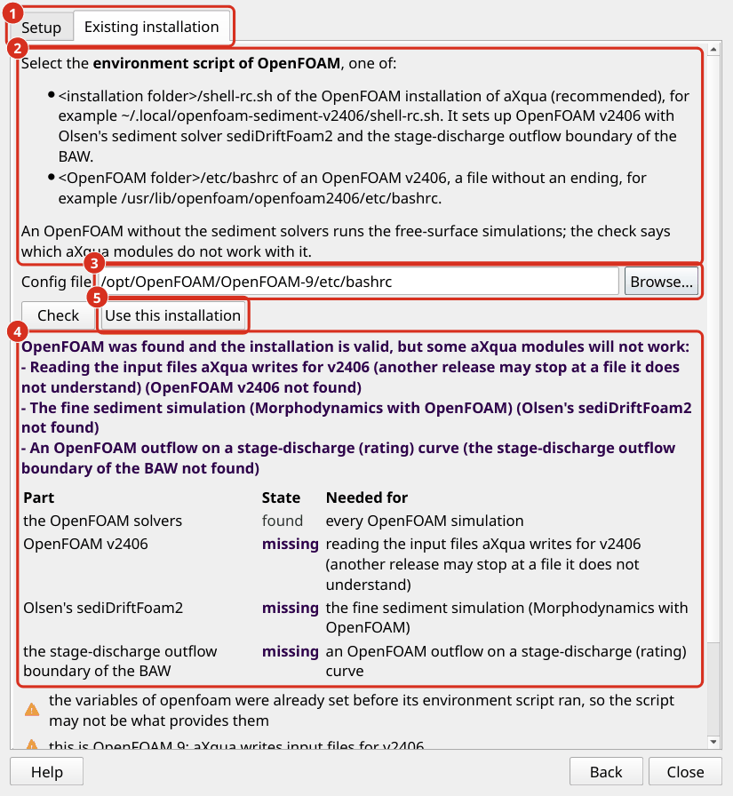
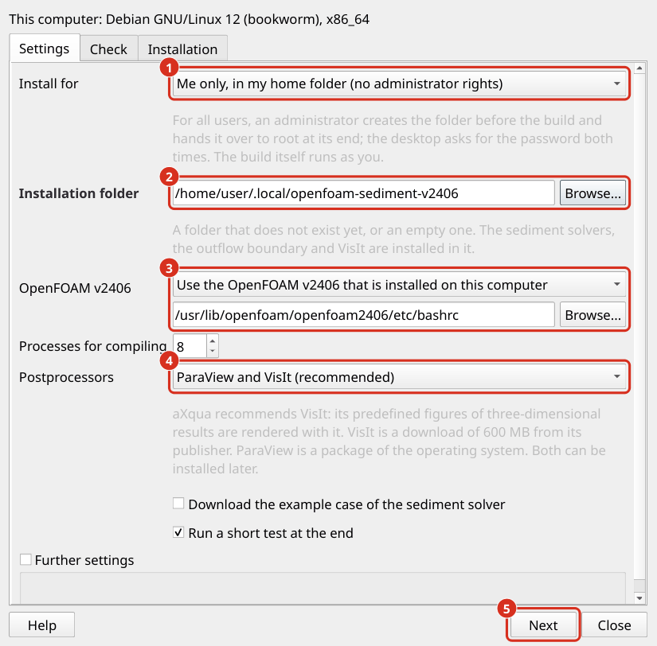

Simulation Software
===================

aXqua prepares and starts simulations, but the numerical codes are separate software that must be installed additionally. The plugin has one *Setup Wizard* for TELEMAC and one for OpenFOAM, which either enters an existing installation in the profile of the computer or installs the program. Set up TELEMAC first. OpenFOAM (including postprocessors) is optional and builds on TELEMAC.

.. note::
   On Windows, QGIS, the plugin and the aXqua program run in Windows. TELEMAC can run in one of two ways: inside the Windows Subsystem for Linux (WSL 2), described in this note, or as a Windows program built in your user folder, which needs no administrator and no WSL but runs on one processor core only (:ref:`TELEMAC built on Windows <setup-telemac-windows-native>`). OpenFOAM runs inside WSL only.

   An administrator of the computer sets up WSL once: ``wsl --install -d Ubuntu-24.04`` in a terminal with administrator rights, then a restart; then open *Ubuntu* from the Start menu and create a Linux user. Nothing after this step needs an administrator:

   * The *Setup Wizard* installs TELEMAC and OpenFOAM into the default distribution, into a folder of the Linux file system (a build in a Windows folder such as ``/mnt/c/...`` is slower by an order of magnitude). Missing system packages are installed as the root of the distribution, which needs no password and no administrator of Windows. At its end, the wizard enters the installation in the profile of the computer as an installation in WSL.
   * To use an existing installation, open *Linux* in the file dialog of *Select existing config file* (the folder ``\\wsl.localhost``), then the distribution, and select the environment script there.
   * ParaView and VisIt are Windows programs on Windows: install them from their websites (the ZIP of ParaView needs no administrator) and enter them in the profile.
   * The Bayesian calibration with HydroBayesCal is not yet available on Windows with TELEMAC inside WSL; building, running and validating a case are.

   This route has been tested with a stand-in for WSL only, not yet on a real Windows installation with WSL.

Installation wizards (short version)
------------------------------------

The wizards are opened on the *Configuration* tab, in the box *Simulation & postprocessing software* showing the operating system that the aXqua *Check* button detected. TELEMAC and OpenFOAM each have the button *Setup Wizard...*, and ParaView and VisIt the button *Install ParaView and VisIt...* (:ref:`help-postprocessors`).

.. note::
    If the aXqua program *Check* identified existing TELEMAC, OpenFOAM or postprocessor software installation, the box states for each program where it is installed or that it was not found.

The first tab of the *Setup Wizard*, *Setup*, asks how aXqua is to find the program:

* *Select existing config file* is the choice for a program that is installed on this computer already. *Next* opens the tab *Existing installation*, which states which file to select: the **environment script** of the installation, which sets all variables the program requires (TELEMAC: :ref:`existing TELEMAC <setup-existing-telemac>`; OpenFOAM: :ref:`existing OpenFOAM <setup-existing-openfoam>`). Select it with *Browse...*, and aXqua checks whether the installation is usable for aXqua. *Use this installation* enters the script and the installation folder in the profile (:ref:`plugin-profile`).
* **Install <software-name>** is the choice for a computer without the program. The button *Next* reads *Install <software-name>...* and opens the installation wizard.

The check of an existing installation loads the environment script once and looks for every part of the installation that aXqua uses. It answers with one of three verdicts, and lists each part as *found* (dark green) or *missing* (bold dark purple) with what it is needed for:

* *... was found and the installation is valid and complete.*
* *... was found and the installation is valid, but some aXqua modules will not work:* the program runs, and the list names the aXqua modules that lack a part, for example the morphodynamics without GAIA in TELEMAC, or the fine sediment simulation without Olsen's sediDriftFoam2 in OpenFOAM. Everything else works, and the installation can be entered in the profile.
* *This is not a usable installation of ...:* the script does not set up the program, or a part that every simulation needs is missing. *Use this installation* stays disabled.

The warnings and errors of the check are explained in :ref:`axqua-environment-module-missing` and :ref:`axqua-environment-solver-incomplete`. The *Check* button of the profile on the *Configuration* tab reports the same for the programs the profile names.

   The tab *Existing installation* of the OpenFOAM *Setup Wizard*, for an OpenFOAM of another release than v2406 and without the sediment solvers. (1) The tab *Setup* with the choice between an existing installation and installing the program. (2) Which file to select. (3) The selected environment script. (4) The verdict and the parts of the installation. (5) *Use this installation* enters it in the profile.

The installation wizard has three intuitive tabs in which users make choices according to their needs:

#. *Settings*: Installation folder and installer choices. Every folder and file is selected in a dialog, so nothing has to be typed. Details on software-specific settings are provided below on this page.
#. *Check*: aXqua examines the computer and lists the commands that it is about to run, expected duration, and everything that is not in order. An orange triangle marks a warning, with which the installation can be started. A dark red triangle marks an error. To proceed with the installation:
    * Carry out what the box under *REQUIRED USER ACTIONS in TERMINAL:* asks for.
    * Then click *Install* at the bottom left.
#. *Installation*: Run and show the current step and the end of the installation log. The installation is a process of its own: the wizard and QGIS can be closed while it runs. The *Configuration* tab reports that an installation is running, and the wizard shows it again when it is reopened.

The tabs can be visited in any order, and *Back* and *Next* at the bottom of the wizard walk through them. Changed settings are checked again when the *Check* tab is opened.

At the end, aXqua verifies that the installer produced the program, enters the program and its installation folder in the computer profile (:ref:`plugin-profile`), and starts it once. After a successful installation, the button *Cancel the installation* turns dark gray-green and reads *Installation complete*; a click closes the wizard. No further configuration is required.

In the box *Simulation & postprocessing software*, the path of a program that was found is written in dark green, and *Not found on this computer.* in bold dark purple. For a program that was found, the *Setup Wizard* fills in its environment script and selects *Select existing config file*. Choosing *Install <software-name>* for a program that is installed already first asks *Software already installed. Continue with re-installation?* *No* returns to the *Configuration* tab. *Yes* opens the wizard, whose *Settings* tab then starts with the setting *Existing installation*:

* *Remove the existing installation and install it again in its folder* deletes the earlier installation before the new one is built. aXqua removes only an installation that one of its installers made: the subfolder ``telemac-mascaret`` of TELEMAC, a folder of the OpenFOAM installer, or the VisIt folders of the postprocessors.
* *Continue in the existing folder* keeps what is downloaded and built and repeats the remaining steps. The OpenFOAM installer refuses to continue a folder that another version of it started; the *Check* tab says so before anything runs.
* *Install it again in a new folder* leaves the existing installation untouched.

.. note::
    The wizards run installer scripts of the `installer repository <https://github.com/Ecohydraulics/numerical-software-installers>`_, in the version with which this version of aXqua was tested. The OpenFOAM installer of that repository is shipped with aXqua, together with the source code of Olsen's sediment solvers, so that installing OpenFOAM does not depend on the website where Nils Reidar Olsen publishes them (the repo was unreachable with the error HTTP 502 in October 2026). The scripts exist for Debian 12, Ubuntu 22.04, Ubuntu 24.04 and Linux Mint 22. For another system that is built on one of these, select the base system under *Further settings* on the *Settings* tab.

User rights
-----------

**System packages and administrator rights:** Compilers and numerical libraries are packages of the operating system, and installing them is the only step that requires administrator rights. The *Check* tab states how many of the required packages are missing and shows the one command that installs them in a box below the heading *REQUIRED USER ACTIONS in TERMINAL:*, both in dark purple. The command can be run in two ways:

* *Run fixes* runs the command. On a desktop, the password dialog of the desktop asks for the password; otherwise a terminal window opens and asks for it. The password does not pass through the plugin. aXqua then checks the computer again and repeats the fixes as long as they make progress.
* *Copy the command* places the command in the clipboard, to be pasted into a terminal. On a computer that is managed by an institution, send the command to the administrator.

If the fixes do not solve the problem, for instance because the same packages remain missing, the button *Report issue* appears. It opens a window with a report of the computer, the command, and what the check found, in which your home folder is written as ``~``. The report can be read and changed before it is sent: *Open on GitHub* opens a new issue in the `issue tracker <https://github.com/sschwindt/aXqua/issues>`_ (a free GitHub account is required), *Send by e-mail* opens the mail program with the report (no account is required), and *Copy report* places it in the clipboard. A failed installation offers the same button on the *Installation* tab, with the end of the installation log in the report.

**For me only, or for all users:** The first setting of each wizard, *Install for*, decides who can use the program:

* *Me only* (the default) installs into a folder in your home folder: ``~/opt`` for TELEMAC, ``~/.local/openfoam-sediment-v2406`` for OpenFOAM, and ``~/.local/axqua-postprocessors`` for VisIt. The installation itself requires no administrator rights; only missing system packages do, as described above.
* *All users of this computer* installs into a folder below ``/opt``: ``/opt/telemac``, ``/opt/openfoam-sediment-v2406``, or ``/opt/axqua-postprocessors``. The build still runs under your user account, because the installers refuse to compile as the administrator. The password of an administrator is asked twice: before the build, to create the folder for you, and at its end, to hand the folder over to the administrator, readable for every user and writable for nobody else. The aXqua of every other user finds the programs in these folders without any entry in their profile. Changing the folder later, for example to add the example cases of TELEMAC, again requires an administrator.

On the desktop, the password dialog of the desktop asks for the password. In a terminal, ``axqua install start openfoam --for-all-users --foreground`` lets ``sudo`` ask for it; a detached installation without a desktop cannot ask and stops before it builds anything.

Click *Check again* afterwards. The installation itself runs with the rights of the ordinary user and writes into the installation folder only.

**From a terminal.** Each wizard corresponds to one command, ``axqua install``, which does the same without QGIS (:doc:`../automation/terminal-syntax`).

.. _install-telemac:

TELEMAC
-------

`TELEMAC <http://www.opentelemac.org/>`_ solves the depth-averaged (2D) and 3D flows, coupled with a large variety of modules for purposes like sediment transport (Gaia), water quality analysis (WAQTEL), wave propagation (ARTEMIS and TOMAWAC). Its sediment transport module GAIA is part of the same installation. aXqua is developed and tested with TELEMAC v9.1.1.

Click *Setup Wizard...* in the row of TELEMAC on the *Configuration* tab, and select *Install TELEMAC*. The installation wizard is available on Debian 12, Ubuntu 24.04 and Linux Mint 22, and on Windows (:ref:`TELEMAC built on Windows <setup-telemac-windows-native>`). On Linux, its *Settings* tab has four settings besides *Install for*:

.. list-table::
   :header-rows: 1
   :widths: 26 74

   * - Setting
     - Meaning
   * - *Installation folder*
     - TELEMAC is installed in the subfolder ``telemac-mascaret`` of this folder. The default is the folder ``opt`` in the home folder. If the subfolder exists already, the installer keeps its source code and builds TELEMAC in it again.
   * - *TELEMAC version*
     - Leave the field empty for v9.1.1.
   * - *Example cases of TELEMAC*
     - TELEMAC is distributed with about 830 example cases. Their steering files are always installed with the source code. The setting selects how many of their large files are downloaded in addition. *Input files of examples only* (the default) downloads what a run of an example reads, which is mainly its mesh: about 360 files and 460 MB. *Everything* also downloads the reference results, with which TELEMAC validates itself, and the manuals: 1,500 files and 1.65 GB, which takes about one hour. *Steering files only* downloads none of the large example files. aXqua itself requires none of these files.
   * - *SALOME archive*
     - Optional. A downloaded archive of SALOME, which is then installed next to TELEMAC. aXqua uses `Gmsh <https://gmsh.info/>`_ (Geuzaine and Remacle 2009) and does not require SALOME, because it generates the mesh and the input files itself.

The installation downloads the source code of TELEMAC and compiles it for parallel computation with the system libraries MPI, MUMPS, METIS and MED. It requires about 2.5 GB of free space with the input files of the example cases and about 5 GB with everything. On a workstation with 32 processor cores, the installation with the default setting took 11 minutes, of which the input files of the example cases took 7 minutes.

The large files of the example cases are stored separately from the source code, and the download server delivers them one at a time when all of them are requested. For this reason, the default setting requests only the files that a run reads. aXqua determines these files from TELEMAC itself: the keyword dictionaries of TELEMAC state for every file whether a run reads or writes it. The missing files can be downloaded at any time afterwards: ``axqua install telemac-examples <folder>`` downloads the input files that are still missing, and ``git lfs pull`` in the folder ``telemac-mascaret`` downloads everything.

The result is the file ``telemac-mascaret/configs/pysource.<system>.sh`` in the installation folder. This file is the **environment script** of TELEMAC: it sets all variables that TELEMAC requires. The wizard enters it in the profile as the solver binding of TELEMAC (:ref:`solver-bindings`).

If the installation fails, the wizard shows the last lines of the installation log and the location of the complete log. After the cause is corrected, start the wizard again with the same folder. The installer continues with what is already downloaded.

A manual installation is described in the `TELEMAC installation tutorial <https://hydro-informatics.com/get-started/install-telemac-autoinstaller.html>`_.

.. _setup-existing-telemac:

**Use an existing installation of TELEMAC.** Click *Setup Wizard...* in the row of TELEMAC, select *Select existing config file* and click *Next*. Select the environment script of the installation, which is in the folder ``configs`` of TELEMAC and whose name starts with ``pysource.`` and ends with ``.sh``:

.. code-block:: text

   <installation folder>/telemac-mascaret/configs/pysource.<configuration>.sh

for example ``/opt/telemac/telemac-mascaret/configs/pysource.debian12.sh``. A TELEMAC installation has one such script per configuration of its build; select the one of the build you use. A file whose name contains ``template`` is an example and sets up nothing. The check looks for TELEMAC-2D, which every simulation needs, and for TELEMAC-3D (3D simulations and the vertical convergence study), GAIA (morphodynamics, also in the hydrology mode), parallel runs (``partel`` and an MPI launcher) and the Fortran compiler of the build (user Fortran, which the Green-Ampt infiltration of the hydrology mode and the gain-lose exchange compile). The same script can be entered by hand in the profile editor (:ref:`solver-bindings`).

.. _setup-telemac-windows-native:

**TELEMAC built on Windows, without WSL.** On a Windows computer where WSL cannot be set up, for example without administrator rights, the *Setup Wizard* compiles TELEMAC as a Windows program in your user folder. Nothing of this needs administrator rights. The resulting TELEMAC has no parallel computing (no MPI) and runs every simulation on one processor core. On Windows 11 without administrator rights, the wizard built TELEMAC v9.1.1 with TELEMAC-2D in 16 minutes, and a build with the same commands ran the steady simulation of the Isar example case to its end in 58 minutes on one core. Only TELEMAC-2D was tested. TELEMAC-3D, morphodynamics with GAIA, the hydrology mode and the calibration with HydroBayesCal have not been tested on Windows yet.

Click *Setup Wizard...* in the row of TELEMAC on the *Configuration* tab, and select *Install TELEMAC*. When aXqua already knows a TELEMAC on this computer, it asks whether to install it again: answer *Yes*, and keep *Install it again in a new folder* on the *Settings* tab to leave the existing TELEMAC as it is. On Windows, the *Settings* tab then has the setting *Build TELEMAC*:

* *In Windows itself: one processor core, no administrator* is the only choice on a computer without WSL.
* *Inside WSL: parallel runs; WSL must be set up by an administrator* is offered when WSL is set up, and is then the default (see the note at the top of this page).

Built in Windows itself, TELEMAC has these settings:

.. list-table::
   :header-rows: 1
   :widths: 26 74

   * - Setting
     - Meaning
   * - *Installation folder*
     - The default is ``opt\telemac`` in your user folder, and a new folder next to the existing one when TELEMAC is installed again. The source code and the build go into its subfolder ``telemac-mascaret``, the compilers into its subfolder ``telemac-build``. The path must not contain spaces.
   * - *Modules*
     - *TELEMAC-2D with GAIA* (the default) is the build that was tested on Windows. *All modules, also TELEMAC-3D* takes longer to compile and has not been tested on Windows yet.
   * - *TELEMAC version*
     - Leave the field empty for v9.1.1.

In a new folder, the *Check* tab lists five steps:

#. *Download the compilers (conda-forge)*: a conda environment with the GNU compilers for Windows (MinGW-w64), CMake, Make and Git, a download of several hundred MB. It is created with the conda of the installation that aXqua runs from, so for this route aXqua must be installed in a conda environment (Miniforge, Miniconda or Anaconda), as :doc:`qgis-plugin` describes.
#. *Download the source code of TELEMAC* with Git, without the large files of TELEMAC's own example cases.
#. *Configure the build* with CMake and MinGW Makefiles, without MPI, MED and MUMPS.
#. *Compile TELEMAC*. TELEMAC-2D took 10 minutes with 8 processes on the test computer.
#. *Write the environment script* ``telemac-mascaret\configs\pysource.win.bat``. It only sets variables and changes nothing on the computer. aXqua then enters it in the profile, as at the end of every installation, unless *Enter the installation in the profile of this computer* is cleared (``--no-bind`` in a terminal). The *Configuration* tab then shows it in the row of TELEMAC.

The installation goes on when the wizard or QGIS is closed. After QGIS is opened again, the button in the row of TELEMAC reads *Show the installation...* and opens the wizard on its *Installation* tab. In a terminal, ``axqua install status telemac --tail 20`` shows the step and the last lines of the log. The log, ``install.log`` in ``%LOCALAPPDATA%\axqua\installs\<installation>``, gives the start and the duration of each step.

When the server of TELEMAC does not answer (it returned the error HTTP 504 on 9 November 2026), the installation stops at the second step. Start it again later with the same *Installation folder*: the plan then has fewer steps, because the compilers are kept, and a source code that was downloaded completely is kept too. In a terminal (the *Anaconda Prompt* or *Miniforge Prompt*), ``axqua install start telemac --native`` does the same as the wizard; give it the folder of the first attempt with ``--folder``.

aXqua runs the Python scripts of TELEMAC with the Python of the aXqua environment. The check of the profile reports that parallel runs are not available. A job then runs on one core: a number of processes that comes from the case or the computer profile becomes 1, with a warning in the message bar of QGIS and at the top of the log of the job. A number above 1 that is asked for with the job (*MPI processes* in the plugin, ``--np`` in a terminal) is refused before the job starts, because TELEMAC would stop with the error *Parallel inconsistency*. Cancelling a job ends TELEMAC and every process it started. A TELEMAC built on Windows by hand is entered with *Select existing config file* and its ``configs\pysource.<configuration>.bat``.

.. _install-openfoam:

OpenFOAM
--------

`OpenFOAM <https://www.openfoam.com/>`_ enables a better resolution of flow in 3D, which is particularly important for the simulation of hydraulic structures such as weirs or vertical slot fishways. aXqua is designed to function with **OpenFOAM v2406** as distributed by OpenCFD (``openfoam.com``), which is compatible with the sediment transport solvers **sediDriftFoam** (`Olsen et al. 2023 <https://doi.org/10.2166/hydro.2023.309>`_) and **sediDriftFoam2** (`Olsen 2025 <https://doi.org/10.2166/hydro.2025.059>`_). The releases of the OpenFOAM Foundation (``openfoam.org``) use different file formats and do not read the input files that aXqua writes.

.. important::

   Install TELEMAC also when OpenFOAM is the code of interest. aXqua starts every OpenFOAM simulation from the result of a short TELEMAC run, which is called the warm-up (:ref:`warm-up-concept`). Without it, OpenFOAM has to fill a dry riverbed with water on its own, which multiplies the computing time.

Click *Setup Wizard...* in the row of OpenFOAM on the *Configuration* tab, and select *Install OpenFOAM*. The installation wizard is available on Debian 12, Ubuntu 22.04, Ubuntu 24.04 and Linux Mint 22, on computers with an x86-64 processor. It installs the following components into one folder:

* **OpenFOAM v2406**, unless an installation of this version exists already (see the settings below).
* The sediment transport solvers **sediDriftFoam** (`Olsen et al. 2023 <https://doi.org/10.2166/hydro.2023.309>`_) and **sediDriftFoam2** (`Olsen 2025 <https://doi.org/10.2166/hydro.2025.059>`_), and a variant of the latter with a stage-discharge outflow, ``sediDriftFoam2Rating``, which the installer marks as not validated.
* The **stage-discharge outflow boundary** of the Federal Waterways Engineering and Research Institute (BAW) for the solver ``interFoam`` (`Thorenz 2024 <https://doi.org/10.3929/ethz-b-000675949>`_).
* The postprocessors **ParaView** and **VisIt** (:ref:`help-postprocessors`), unless they are deselected.

.. list-table::
   :header-rows: 1
   :widths: 26 74

   * - Setting
     - Meaning
   * - *Installation folder*
     - A folder that does not exist yet, or an empty one. The installer installs into a new folder or continues an installation of its own, and refuses any other folder.
   * - *OpenFOAM v2406*
     - *Use the OpenFOAM v2406 that is installed on this computer* builds the solvers on an existing installation, which takes a few minutes. aXqua enters the installation that it found. Select the file ``etc/bashrc`` of another one with *Browse...*. *Compile OpenFOAM v2406 from its source code* is the choice for a computer without OpenFOAM. It takes several hours and requires about 20 GB of free space.
   * - *Processes for compiling*
     - The number of processor cores used for compiling. Each process requires about 2 GB of memory.
   * - *Postprocessors*
     - *ParaView and VisIt* is the default and the recommended choice, because aXqua renders its predefined three-dimensional figures with VisIt. *ParaView only* leaves VisIt out, which saves a download of 600 MB. *None* installs neither program, for a computer on which both are installed already. A program that was left out can be installed at any time afterwards (:ref:`help-postprocessors`).
   * - *Download the example case of the sediment solver*
     - Adds the example case that is published with sediDriftFoam.
   * - *Run a short test at the end*
     - Runs ``interFoam`` for a few time steps with the outflow boundary of the BAW, which verifies that the compiled library can be loaded.

   The *Settings* tab of the OpenFOAM wizard. (1) For whom the program is installed: for you alone, or for all users of the computer. (2) The installation folder. (3) The existing OpenFOAM v2406 on which the solvers are built, or the choice to compile it. (4) The selection of the postprocessors. (5) *Next* leads to the tab *Check*.

A packaged OpenFOAM v2406 saves the hours of compilation. OpenCFD provides packages for Debian and Ubuntu. An administrator installs them according to the `installation instructions of OpenCFD <https://develop.openfoam.com/Development/openfoam/-/wikis/precompiled/debian>`_, which creates the file ``/usr/lib/openfoam/openfoam2406/etc/bashrc``. The wizard finds this installation by itself.

The result is the file ``shell-rc.sh`` in the installation folder. It is the **environment script** of this installation: it loads OpenFOAM v2406 and adds the compiled solvers and the boundary library. The wizard enters it in the profile as the solver binding of OpenFOAM, and enters the selected postprocessors. No existing OpenFOAM installation and no startup file of the user account is changed.

.. _setup-existing-openfoam:

**Use an existing installation of OpenFOAM.** Click *Setup Wizard...* in the row of OpenFOAM, select *Select existing config file* and click *Next*. Select one of two environment scripts:

* ``<installation folder>/shell-rc.sh`` of an OpenFOAM installation that the wizard made, for example ``~/.local/openfoam-sediment-v2406/shell-rc.sh``. This is the recommended choice, because it also sets up the sediment solvers and the outflow boundary of the BAW.
* ``<OpenFOAM folder>/etc/bashrc`` of an OpenFOAM v2406, a file without an ending, for example ``/usr/lib/openfoam/openfoam2406/etc/bashrc`` of the package of OpenCFD.

The check looks for the solvers that every aXqua simulation uses (``interFoam``, ``checkMesh``, ``decomposePar``, ``reconstructPar``), and for the release v2406, Olsen's ``sediDriftFoam2`` (the fine sediment simulation) and the stage-discharge outflow boundary of the BAW (an outflow on a rating curve). An OpenFOAM without the sediment solvers, or of another release, is reported as valid with the modules that will not work: the free-surface simulations run with it. To add the sediment solvers to an OpenFOAM v2406, select *Install OpenFOAM* and *Use the OpenFOAM v2406 that is installed on this computer*, which compiles only the solvers and the boundary library.

.. note::

   aXqua sets up simulations with the sediment transport solver sediDriftFoam2, for fine sediment over a bed that stays in place (*Simulations > Morphodynamics* with the simulation program *OpenFOAM*, :ref:`help-morphodynamics-openfoam`), and OpenFOAM simulations with the stage-discharge outflow boundary of the BAW (``openfoam.outflow_boundary: rating-curve``, :ref:`preprocessing-openfoam-choices`). The variant ``sediDriftFoam2Rating``, which moves the bed and the water surface, is installed but not set up by aXqua, because aXqua keeps the bed and the surface of a sediment simulation in place.

.. rubric:: References

Geuzaine, C., Remacle, J.-F., 2009. Gmsh: A 3-D finite element mesh generator with built-in pre- and post-processing facilities. International Journal for Numerical Methods in Engineering 79, 1309–1331. https://doi.org/10.1002/nme.2579
