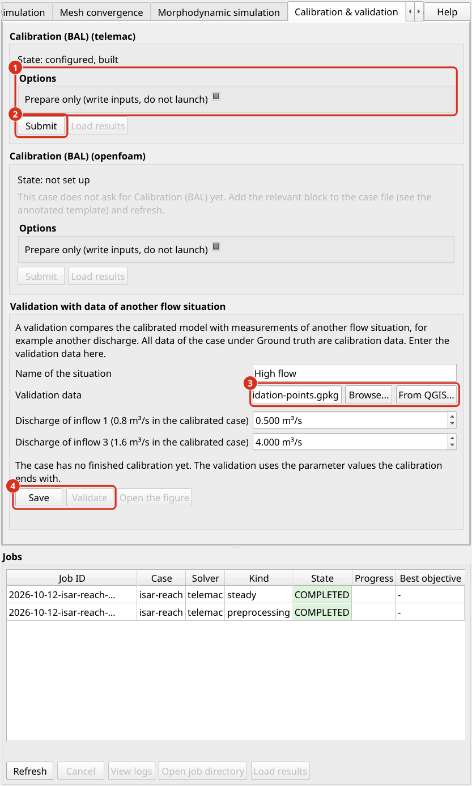

.. _help-calibration:

Calibration & validation
========================

A numerical model contains parameters that cannot be measured directly, most importantly the roughness of the riverbed. **Calibration** adjusts these parameters until the model reproduces field measurements. **Validation** then tests the calibrated model against measurements that were not used for the calibration. aXqua performs both with `HydroBayesCal <https://hydrobayescal.readthedocs.io>`_.

Two terms are used throughout this section. **Calibration parameters** are the uncertain inputs of the model that are adjusted, for example the roughness of a zone. **Calibration targets** are the measured quantities that the model is compared with, for example the water depth at surveyed points.

.. _calibration-introduction:

Introduction to Bayesian calibration
------------------------------------

A calibration by trial and error ends with one set of parameter values and no statement about how reliable these values are. Bayesian calibration answers a more useful question: which parameter values are probable, given the measurements and their errors?

The user states for each calibration parameter the range in which its true value is expected. This range is the **prior** distribution. Bayes' theorem combines the prior with the measurements. Parameter values with which the model reproduces the measurements become more probable, and all others become less probable. The result is the **posterior** distribution of each parameter. A narrow posterior indicates that the measurements determine the parameter well. A posterior that is as wide as the prior indicates that the measurements contain no information about this parameter.

The direct evaluation of Bayes' theorem requires many thousands of model runs, which is not feasible for a model that runs for hours. HydroBayesCal therefore replaces the model by a **surrogate model**, in the following steps:

#. The numerical model is run for a limited number of parameter combinations that are spread over the prior ranges (30 by default).
#. A Gaussian process emulator is trained with these runs. The emulator is a statistical model that predicts the result of the numerical model for any parameter combination within a fraction of a second, together with the uncertainty of its own prediction (Rasmussen and Williams 2006).
#. The emulator is evaluated for thousands of parameter combinations to compute the posterior distribution.
#. **Bayesian active learning** selects the parameter combination at which one additional run of the numerical model improves the emulator the most. The model is run for this combination, and the emulator is trained again (Oladyshkin et al. 2020).
#. Steps 3 and 4 are repeated until the selected number of runs is reached (50 by default).

In this way, a few dozen model runs are sufficient where a direct Bayesian calibration would require thousands. Applications to reservoir models are documented by Mouris et al. (2023) and Schwindt et al. (2023).

.. _calibration-ground-truth:

Ground truth data setup
-----------------------

Field measurements are called ground truth. Where the measurements have not been taken yet, the :ref:`survey planner <help-survey-planner>` at the end of this section determines where the calibration needs them. aXqua accepts measurements in a workbook with a fixed structure, which is called the calibration target template. Create it for a case with:

.. code-block:: text

   axqua targets <case-file>

The command writes the workbook ``calibration-target-data.xlsx`` into ``user-sources/ground-truth/``. Its sheets are:

.. list-table::
   :header-rows: 1
   :widths: 24 76

   * - Sheet
     - Content
   * - ``hydraulics``
     - One row per measurement point: velocity components, their fluctuations, water depth and bed elevation. The velocity magnitude and the turbulent kinetic energy are computed by formulas in the sheet.
   * - ``morphodynamics``
     - Grain sizes (d16 to d90) and the fraction of fine sediment per sample. The measured bed change is filled in automatically from the DEM of difference (:ref:`case-morphodynamics`).
   * - ``parameters``
     - The calibration parameters with their lower and upper limits, selected from a list of available TELEMAC and GAIA parameters.

Each row carries an ID. The positions of the measurements are read from a point layer that contains the same IDs, so that coordinates do not have to be typed in. Enter the workbook and the point layers in the case file:

.. code-block:: yaml

   ground_truth:
     targets:
       file: user-sources/ground-truth/calibration-target-data.xlsx
       hydraulics_positions: user-sources/geodata/measurement-points.gpkg
       sediment_positions: user-sources/geodata/sediment-samples.gpkg
       join_key: ID

Then repeat the preprocessing, which compiles the measurements into the tables that the calibration reads. The IDs have to be unique within a sheet. Measurements of several survey days whose numbering restarts at zero therefore need distinct IDs.

Two alternatives to the workbook exist. ``ground_truth.measurements`` names a table that the user compiled, with the coordinates x, y and z in the first three columns and one column per measured quantity. ``ground_truth.sources`` lists original instrument files together with the point layer of their positions, which aXqua compiles into such a table.

**Measurements in one layer or table.** If the measured values and their positions already exist in one file, this file is sufficient. Enter it as a source of the kind ``points``:

.. code-block:: yaml

   ground_truth:
     sources:
       - category: hydraulics
         kind: points
         positions: user-sources/ground-truth/velocity-measurements.gpkg

The file is a point layer (GeoPackage, shapefile or GeoJSON) in any coordinate reference system, or a table (CSV file or Excel workbook) with the columns ``x`` and ``y`` in the coordinate reference system of the case. aXqua recognizes the following column names, in upper or lower case and with or without a unit in square brackets or parentheses, for example ``v(x) [m/s]`` or ``v_x (m/s)``:

.. list-table::
   :header-rows: 1
   :widths: 44 56

   * - Quantity
     - Column names
   * - Coordinates of a table
     - ``x`` and ``y``, or ``easting`` and ``northing``
   * - Velocity components in m/s
     - ``u``, ``v``, ``w``, or ``v(x)``, ``v(y)``, ``v(z)``, or ``v_x``, ``v_y``, ``v_z``, or ``VelX``, ``VelY``, ``VelZ``
   * - Total water depth in m
     - ``h``, ``depth``, ``water_depth`` or ``Total Depth``
   * - Depth of a reading below the water surface in m
     - ``MeasD`` or ``Meas. Depth``

The velocity magnitude that is compared with the model is computed from the horizontal components. The velocity of each measurement vertical is compared at 0.6 of the water depth above the riverbed. Where a layer contains several readings at one position, below and above that height, aXqua fits a logarithmic velocity profile to the readings at their measured heights and reads the velocity at 0.6 of the water depth above the riverbed off this profile. The profile is not extended beyond the readings: any other vertical (a single reading, readings all below or all above that height, or a velocity that does not grow with height) is represented by its reading nearest that height, which is moved there along a logarithmic profile with the roughness length of its own readings, or else with the median roughness length of the same survey. The measurement depth of a reading (*Meas. Depth* of a FlowTracker) counts down from the water surface. A reading without a recorded depth is taken to stand at 0.6 of the water depth above the riverbed and is used as it is. Points outside the model outline are left out of the calibration, and so are points less than 15 mesh nodes from an inflow or outflow line: there, the flow is what the boundary prescribes, not what the river does. aXqua names these points and the boundary they are close to in a warning, which the plugin shows when the results of the job are loaded, together with the remedy: *Increase ROI beyond the concerned liquid boundary.* A model outline that reaches further upstream or downstream than the measurements keeps them away from the boundaries. In the plugin, the files are entered in the case settings (*Open case settings...* on the *Case Setup* tab), page *Calibration and validation*, in the table *Measurement files* of the frame *Measurements*. *Add file...* adds a point layer or a table, and the column *Use for* assigns each file to the calibration or to the validation. A file for the validation needs the name of its flow situation and its discharge (:ref:`validation situation <validation-setup>`).

Velocity measurements with a SonTek FlowTracker2 are transferred into the ``hydraulics`` sheet with the script ``extract_flowtracker.py``, which aXqua places next to the workbook. Note that the velocity fluctuation is the standard deviation of the velocity samples. It is not the column ``VxErr`` of the instrument export, which is the standard error of the mean velocity.

.. _help-survey-planner:

**The survey planner.** Calibration can only determine a parameter where a measurement responds to it. A roughness zone without a measurement point is therefore not calibrated (:ref:`calibration-setup`), and a turbulence parameter is constrained by measurements in shear zones, not in the uniform flow of the main channel. The survey planner answers two questions before the field work: where does the calibration need measurements, and how long does the survey take? It places the measurements in the flow field of the model, so it requires a built case and a steady simulation at the discharge that is expected on the survey day (:ref:`help-hydraulics`). Open it with *Survey planner...* on the tab *Calibration & validation*. Its window has eight tabs, which can be visited in any order:

.. list-table::
   :header-rows: 1
   :widths: 20 80

   * - Tab
     - Content
   * - *Survey*
     - The kinds of survey to plan, the calibration parameters with the rule that places their measurements, the number of measurements per parameter, and the result file to plan with (the steady run of the case unless another file is named).
   * - *Access*
     - The points where the surveyors reach and leave the river. *Set points on the map* creates ``survey-plan.gpkg`` with the layer ``access_points``, adds the layer to the map, and starts editing it. Click on the map to set a point and select its role: ``access`` (start and end of a wading survey, put-in of the kayaks), ``leave`` (take-out of the kayaks), or ``takeoff`` (take-off point of the drone, if it is not the access point). *Save the points* ends the editing. *Draw areas on the map* and *Save the areas* do the same for the layer ``walkable_areas``, the polygons of dry ground that can be walked on (see ground-based velocimetry below).
   * - *Ground-based*, *Airborne*, *Kayak*, *Temperature*
     - The assumptions of each kind of survey, with the defaults described below. Every value can be changed.
   * - *Time and weather*
     - The survey day and the start of the working day (both optional), the longest working day, and the breaks. *Look up* reads sunrise, sunset, the weather forecast and what is known about the network coverage at the reach, and suggests a start time.
   * - *Plan*
     - *Plan the survey* computes the plan, adds its layers to the map, and lists the maps and factsheets, which open with a click.

The planner reads the calibration parameters from the case file and suggests a placement rule for each. It also lists every roughness zone of the zone map that the calibration does not name. Such a zone is selected if the case declares no calibration parameter yet, and is listed without being selected otherwise. Parameters that the case does not declare yet can be added with *Add parameter...*:

.. list-table::
   :header-rows: 1
   :widths: 26 74

   * - Rule
     - Where the measurements are placed
   * - *inside a roughness zone*
     - Inside one roughness zone, spread over the water depths and velocities that occur in it. This is the rule of every roughness parameter that belongs to a zone.
   * - *over the wetted model*
     - Spread over the wetted model, for a parameter that acts on the whole reach.
   * - *in shear zones*
     - Where the velocity changes most across the flow, such as the edges of recirculation zones. This is the rule of turbulence parameters.
   * - *in bends*
     - Where the streamlines curve most.
   * - *along the banks*
     - Along the banks, close to the wetted edge. A solid wall of the model counts as a bank where the water reaches it.
   * - *in shallow margins*
     - In the shallow margins that fall dry at a lower discharge.

No measurement is placed closer than 15 mesh nodes to an inflow or outflow boundary, because the flow there is prescribed by the boundary condition and not computed by the model. Six measurements are planned per parameter by default.

**Ground-based velocimetry.** A surveyor wades from the access point to each measurement vertical with a velocity probe, for example a SonTek FlowTracker2, and returns to the access point at the end of the day. The planner places verticals only in water that can be waded, orders the verticals into a short round, and routes the walk on a grid of 1 m cells with the water depths and flow velocities of the result. Terrain beside a river is often next to impassable (riparian forest, riprap, steep banks, private land), and the model contains no information about it. On dry ground, the walk therefore stays within a strip of 1 m along the wetted edge of the result, which is the wetted edge at the discharge of the survey day. This holds for gravel bars inside the model and for the banks outside it. Dry ground that can be walked on beyond the strip, such as a gravel bar, a path or a meadow, is drawn as a polygon in the layer ``walkable_areas`` (tab *Access*); the areas apply to dry ground only and do not carry the walk across water that cannot be waded. An access point that neither the strip nor an area connects to the water is joined to the nearest walkable ground by a straight line, and the plan issues a warning if this line is longer than 10 m, because nothing indicates that it can be walked. The strip ends at the inflow and outflow boundaries of the model, where the river continues, so the walk crosses the river only where the result shows wadeable water. The defaults are:

.. list-table::
   :header-rows: 1
   :widths: 34 66

   * - Assumption
     - Default
   * - Wadeable water
     - Not deeper than 1.2 m. Up to a depth of 0.6 m not faster than 2 m/s, up to 0.9 m not faster than 1.4 m/s, and up to 1.2 m not faster than 1 m/s.
   * - Walking speed
     - 3 km/h on land and 1.5 km/h in the water with the current. Against the current 1 km/h in water deeper than 0.3 m, 0.5 km/h in water deeper than 0.5 m, and 0.1 km/h in water deeper than 0.8 m.
   * - Dry ground
     - Walked on within 1 m of the wetted edge and inside the walkable areas, nowhere else. The width of the strip is the setting *On land, no farther from the wetted edge than* on the tab *Ground-based*.
   * - Time at a vertical
     - 60 s for the water depth, and for every measured depth 40 s to set the probe to its height and 60 s of velocity averaging.
   * - Measured depths
     - One depth in water shallower than 0.3 m (at 0.6 of the water depth above the riverbed), two depths from 0.3 m (0.2 and 0.8), and three depths from 0.5 m (0.2, 0.6 and 0.8). The map shows the three kinds of verticals with different symbols.
   * - Pressure sensor
     - The pressure sensor of the probe is adjusted to the atmospheric pressure at the start and every 4 h. The map shows where.
   * - Positions
     - A second surveyor records the position of every vertical with a DGPS rover while the velocity is measured. The DGPS therefore delays the survey only where it loses its data reception.
   * - Surveyors
     - One surveyor with a probe. With more surveyors, every surveyor gets a walk path of their own, and the DGPS surveyor gets a separate path that visits their verticals. At most three probes per DGPS rover are recommended.
   * - Working day
     - 8 h at most, with a break of 10 min every 2 h and of 30 min every 4 h. A survey that does not fit into one day continues on the next day from the access point.

**Airborne velocimetry.** A camera drone hovers above the river and films tracers on the water surface. Particle tracking or particle image velocimetry (PTV or PIV) with `pXv <https://pxv.readthedocs.io/>`_ turns each video into the surface velocity of the filmed area, so one hover position replaces many verticals, also where the water is too deep or too fast to wade. The planner assumes a DJI camera drone with the camera pointing straight down and plans the hover positions, the flight height above the water surface (40 m by default, 120 m at most), the heading of the frame, the duration of each video (180 s), the route, and the battery changes. The factsheet lists the coordinates of every hover position, the flight settings, the size of the frame on the water, the size of a tracer in pixels, and hints on ground control points and on the calibration panel for the lens correction. Note that the video shows the velocity of the water surface, which is larger than the depth-averaged velocity of a 2D model.

**Kayak drifter velocimetry.** A kayak that is not paddled drifts at the velocity of the water surface. A DGPS rover on the kayak that logs a position every 5 s therefore records the surface velocity along the drift line: only the horizontal position and the distance between two consecutive positions matter (Barker et al. 2018). The planner needs an access point and a leave point. It traces drift lines through the flow field of the model, computes the duration of a float from the modeled velocity, and marks patches faster than 3 m/s, which are to be avoided. Two kayakers are the default for safety reasons; a single kayaker floats the reach twice. A break of 10 min is planned every 2 h, and only a DGPS that loses its connection delays a float. The method is efficient for long reaches, but it requires a pick-up at the leave point and the transport of the kayaks. Velocities measured at a few points with an ADV or an ADCP relate the surface velocity to the depth-averaged velocity and support the validation.

**Water temperature.** The planner sorts the wetted reach into four kinds of water: slow or fast (limit 0.2 m/s) and shallow or deep (limit 0.3 m). Slow, shallow water warms up in the sun within an hour, while deep, fast water carries the temperature of the river upstream, so every kind of water that occurs gets at least one point. The points are either fixed loggers that stay in the river or the readings of a mobile probe that is carried from point to point. The walk to the points follows the rules of the ground-based survey, including the strip along the wetted edge and the walkable areas.

**Time, weather and network coverage.** Without a start time, the timetable of a plan starts at 00:00 and states durations. With the survey day and *Look up*, the planner computes sunrise and sunset for the reach, reads the weather forecast from `Open-Meteo <https://open-meteo.com/>`_, and suggests a start time that keeps the working day within daylight and out of rain and strong wind. With a survey day and a start time, the working day ends at sunset at the latest, and a start time after sunset is refused unless *End before sunset when the day is known* is cleared. For the network coverage it names the coverage map of the national regulator and the real-time correction services of the DGPS for Germany, Switzerland, France, Austria, Italy, the Netherlands, the Czech Republic, Denmark, Sweden, Canada, China and the United States. In Switzerland it also reads the coverage model of the Federal Office of Communications at the reach, and everywhere it counts the mobile masts that OpenStreetMap shows within 5 km. Neither is a measurement of the reception on the river, so every factsheet states where its information comes from and asks the surveyors to check the coverage before the survey. The check box for the look-up can be cleared on a computer without internet access; the plan then contains sunrise and sunset only.

**The plan.** *Plan the survey* writes the folder ``axqua-case/calibration-validation/survey-plan/``:

.. list-table::
   :header-rows: 1
   :widths: 34 66

   * - File
     - Content
   * - ``survey-plan.gpkg``
     - The layers that QGIS shows: the access points, the walkable areas, the verticals (``flowtracker_points``), the walk paths with their direction (``walk_paths``), breaks, pressure adjustments and battery changes (``survey_events``), the hover positions, frames and route of the drone, the drift lines of the kayaks with the patches to avoid, and the temperature points with the four kinds of water.
   * - ``survey-map-<kind>.pdf`` and ``.png``
     - One map per kind of survey on an A4 sheet.
   * - ``survey-factsheet-<kind>.odt``
     - One page per kind of survey for the field: the plan in numbers, the timetable with start, breaks and end, sunrise, sunset and weather, the network coverage, the assumptions, and hints for the field work.
   * - ``survey-plan.json`` and ``survey-settings.json``
     - Every number of the plan, and the assumptions it is based on. The wizard starts with the assumptions of the last plan.

The access points and the walkable areas are kept when a survey is planned again; all other layers are replaced. The layers are replaced only after the maps and factsheets of the new plan have been drawn, so a plan that fails leaves the previous plan in place. A kind of survey that cannot be planned, for example a kayak survey without a leave point, does not stop the others and is listed with its reason. The same plan is available in the terminal:

.. code-block:: text

   axqua survey init <case-file>
   axqua survey plan <case-file> --kinds ground,kayak --date 2026-06-15 --start 08:00

The plan holds for the discharge of the simulation it was computed with. Run the steady simulation again if the discharge on the survey day differs considerably, and move a vertical in the field where the water is deeper or faster than planned. After the survey, the measured values and positions are entered as ground truth as described above.

.. _calibration-setup:

Bayesian calibration & validation setup
---------------------------------------

The ``calibration`` block of the case file defines what is calibrated against which measurements:

.. code-block:: yaml

   calibration:
     calibration_quantities: ["WATER DEPTH"]
     extraction_quantities: ["WATER DEPTH", "SCALAR VELOCITY"]
     measurement_error: 0.10     # used where no measured error is available
     init_runs: 30               # runs for the first training of the emulator
     max_runs: 50                # total number of runs
     parameters:
       - {name: zone1, min: 0.05, max: 0.50}   # ks of roughness zone 1 [m]
       - {name: zone2, min: 0.10, max: 1.00}   # ks of roughness zone 2 [m]

``calibration_quantities`` are the calibration targets. The names are those of the TELEMAC result variables: ``WATER DEPTH``, ``SCALAR VELOCITY``, ``TURBULENT ENERG.`` (requires the k-epsilon turbulence model) and ``CUMUL BED EVOL`` (requires GAIA).

``parameters`` lists the calibration parameters with the limits of their prior ranges. The name ``zone<N>`` refers to the roughness of zone N. A name that starts with ``gaia`` refers to a GAIA keyword, for example ``gaiaCLASSES SHIELDS PARAMETERS 1`` for the critical Shields parameter of the first grain size class. Parameters that are selected in the ``parameters`` sheet of the workbook are added to this list.

Select wide but physically plausible limits. If the posterior of a parameter accumulates at one of its limits, the true value probably lies outside the range, and the calibration has to be repeated with a wider range.

**The outflow level as a calibration parameter.** The outflow level comes from the rating of the outflow cross-section (``outflow_condition: stage_discharge``) or is prescribed (``elevation``). Where the water level of the reach is held up by a control that the terrain model does not resolve, or by one downstream of the model, that level is too low, and no roughness within its range raises the water level at the measurement points. ``outflow_offset`` adds the outflow level to the calibration parameters as an offset in meters to the level of the rating. Every situation keeps the level of the rating at its own discharge, and one offset is calibrated for all situations, as one roughness is:

.. code-block:: yaml

   calibration:
     outflow_offset: [0.0, 2.0]   # range of the offset above the rating level [m]

aXqua writes the TELEMAC routine ``user_sl.f`` into the user Fortran folder of the case. TELEMAC-2D calls it with every prescribed water level, and it adds the offset, raised linearly from 0 over the first 600 s of a run so that a run from the steady result does not start with a step at the outlet. HydroBayesCal sets the offset of each run in that file (parameter ``f.OUTFLOW_OFFSET``), and the validation runs with the calibrated offset. On the Inn reach KB15, the water level in the main channel at the September 2025 points was 0.45 m below the measured one at the level of the rating; an outflow level 1.31 m higher brought it to within 1 cm, while the water level over the patch upstream did not change. The offset is not yet available for TELEMAC-3D, for the outflow condition ``normal_depth`` and for outflow lines without a prescribed level (``free``).

**Which roughness zones are calibrated.** Before a calibration starts, aXqua counts the calibration points in each roughness zone that the roughness table calibrates (the points that the calibration uses, without those outside the model or near an inflow or outflow line). A point counts in the zone whose roughness the mesh gives it. Two rules follow from these counts:

* A zone **without a calibration point** is not calibrated. The measurements contain no information about its roughness, so its posterior would stay as wide as its prior, and the reported value would be a number that the data do not support. The zone keeps the value of the built model, the middle of its range.
* A zone whose water is **shallower than its largest ks** gets a smaller largest ks: when the median measured water depth at its points lies below ``ks_max``, ``ks_max`` is lowered to that depth. The logarithmic friction law of Nikuradse describes a flow that is much deeper than its roughness height. At a relative submergence h/ks below about 1, the roughness elements reach through much of the water column, and the resistance is the form drag of these elements, which the law does not describe. Below h/ks of about 0.09, TELEMAC limits the friction coefficient and prints ``EXTREMLY HIGH VALUE OF FRICTION``. If the lowered limit is not above ``ks_min``, the zone is not calibrated.

Both rules are reported as warnings and written to ``zone-plan.json`` next to the HydroBayesCal configuration. In the plugin, *Submit* on the *Calibration & validation* tab asks first when a zone is left out or its largest ks is lowered: *Calibrate only zones ...* starts the calibration with the zones listed, and *Abort and check the ground truth in QGIS* starts nothing and adds the roughness zones and the calibration points, labeled with their zone, to the map. In a terminal, ``axqua calibration <case-file>`` lists the points, the median measured depth and the decision for each zone without starting anything. On the Inn reach KB15, the first calibration varied zone 4, which has no measurement point, and zone 1, the main channel, with one point; both posteriors stayed nearly as wide as their priors.

.. _validation-setup:

**Validation.** A validation examines whether the calibrated parameters describe the reach, or only the day on which the calibration data were measured. It therefore requires measurements that the calibration has not used and that stem from **another flow situation**: another discharge, measured in another survey.

All measurements of the ``ground_truth`` block are calibration data. aXqua does not withhold a part of them for a validation. The measurements of one survey are taken within a few hours in one flow field, and neighboring points are therefore not independent of each other. A model that predicts some of these points from the others (leave-one-out cross-validation, k-fold cross-validation or a random share) demonstrates that it interpolates within that flow field. It does not demonstrate that its roughness values hold at another discharge, at which other parts of the bed are wetted and other roughness elements are submerged.

The validation data are defined in the case file as a **situation**, with its measurements and its boundary values:

.. code-block:: yaml

   calibration:
     validation:
       - name: September 2025
         inflows: {1: 0.2, 3: 5.1}    # discharge [m3/s] per inflow of the model
         sources:
           - category: hydraulics
             kind: points
             positions: user-sources/ground-truth/september.gpkg

.. list-table::
   :header-rows: 1
   :widths: 26 74

   * - Entry
     - Meaning
   * - ``name``
     - A short name of the situation. It names the files of the validation.
   * - ``sources``
     - The measurements, in the form of the sources of the ``ground_truth`` block.
   * - ``prescribed_flowrate``
     - The total discharge of the situation in m³/s. For a model with several inflows, the discharge is distributed among them in the proportions of the calibrated case.
   * - ``inflows``
     - The discharge of each inflow in m³/s, for a reach whose branches carried another share of the flow. The inflows are identified by the number of their liquid boundary. ``axqua validation <case-file>`` lists the inflows of the model with the discharge that each carries in the calibrated case.
   * - ``prescribed_elevation``
     - The water level at the outflow in m, for a case with ``outflow_condition: elevation``. With a rating curve, aXqua derives the water level from the discharge of the situation.
   * - ``duration``
     - The simulated time in seconds, if it differs from that of the case.

**In the plugin.** The tab *Calibration & validation* has the box *Validation with data of another flow situation*. Select the point layer with the validation data with *Browse...*, or with *From QGIS...* from the point layers that are open in QGIS. Enter the discharge of each inflow: the box lists the inflows of the model with the discharge of the calibrated case. *Save* writes the situation into the case file. The same situations appear in the case settings (*Open case settings...*, page *Calibration and validation*): in the table *Measurement files*, each file whose column *Use for* says *Validation* belongs to the situation named in the column *Situation*, with the discharge of that situation. The discharge belongs to the situation, so a change in one row changes it in every row of that situation, and a path in the columns *File* and *Positions* can be corrected in place. Settings of a situation that the table does not show, such as the discharge of each inflow, are kept.

.. _calibration-run:

Run HydroBayesCal
-----------------

The calibration requires the additional package HydroBayesCal (:doc:`../installation/qgis-plugin`) and a built case with a completed steady simulation. Each run of the calibration repeats this steady simulation with another set of parameter values.

In the plugin, click *Submit* on the *Calibration & validation* tab. The option *Prepare only* writes all input files without starting the runs, so that they can be inspected first. In a terminal:

.. code-block:: text

   axqua submit <case-file> --kind calibration --option prepare_only=true
   axqua submit <case-file> --kind calibration

   The tab *Calibration & validation* for a case with measurements. (1) The option *Prepare only*. (2) *Submit* starts the calibration. (3) The measurements of the validation situation, selected as a file or from the layers that are open in QGIS, and below them the discharge of each inflow in that situation. (4) *Save* stores the validation situation in the case file, and *Validate* runs it.

The computing time is approximately the number of runs (``max_runs``) times the duration of one steady simulation. The job list shows the number of the current run, for example ``iter 5/12``.

**Starting each run from the steady result.** By default, each run repeats the steady simulation from its dry or pre-wetted start, so most of its computing time is spent on filling the reach. With ``hotstart: true``, each run instead continues from the converged result of the steady simulation (``r2d.slf``), and the flow only has to settle to the roughness values being tested:

.. code-block:: yaml

   calibration:
     hotstart: true
     hotstart_duration: 2500    # simulated time of each run [s]; optional

The steering file of these runs is ``calibration2d.cas``, which aXqua derives from the built ``steady2d.cas``. Each run writes its own result file, so the steady result is not overwritten. Without ``hotstart_duration``, each run lasts 1.2 times the residence time of the reach. The residence time is the volume of water in the steady result divided by the discharge, which is the time in which the reach exchanges its water once. On the Inn reach KB15, with the roughness of all calibrated zones at the lower or at the upper limit of their ranges, the flow had settled after this time (3,000 s), and each run took 17 to 29 minutes on 16 cores instead of 56 minutes from the dry start. The same holds when the discharge of a run differs from that of the steady result: started from the result at 54.3 m³/s, runs at 45.8 and 55.4 m³/s with the roughness at the limits of the ranges held their water volume within 0.05 % after approximately 2,400 s, while 1.2 residence times are 3,500 and 2,900 s. The option requires a steady simulation that was run on the current mesh and reached a steady state; aXqua refuses a result of an earlier build. In the plugin, the options are *Start each simulation from the steady result* and *Simulated time of each simulation* in the case settings, page *Calibration and validation*.

HydroBayesCal performs its runs in the folder of the built case (``axqua-case/simulation/``) and writes each tested set of parameter values into the friction table and the steering file there. aXqua restores both files when the calibration ends, so that a later simulation uses the case as it was built. For the same reason, jobs of one case run one after the other: a job that is submitted during a calibration waits until the calibration has ended. The folder ``cases/example-isar/`` of the repository contains a complete example with a run time of about half an hour, including a step-by-step guide for the plugin.

.. _validation-run:

**Validation run.** After the calibration, click *Validate* in the box *Validation with data of another flow situation*, or submit the job in a terminal:

.. code-block:: text

   axqua submit <case-file> --kind validation

The validation runs the calibrated model with the boundary values of the validation situation. Its steering file is derived from that of the built case and differs only in the prescribed discharges and water levels, in the names of its own result files, and in the calibrated parameter values. The mesh and all other settings are those of the calibrated model, so that a difference between model and measurement cannot stem from a model that was built differently. The run starts the way the calibration runs started: from the dry or pre-wetted start of the built case or, with ``hotstart: true``, from the steady result for 1.2 residence times at the discharge of the validation situation. The calibrated values are the per-parameter posterior maxima of the last calibration: for each parameter, the peak of its own posterior distribution. The files of the built case and the result of the steady simulation are not changed.

aXqua then reads the model at the validation points and writes three files into ``axqua-case/calibration-validation/validation/``: a table with the measured and the modeled value at each point (``validation-<name>.csv``), a summary (``validation-<name>.json``), and a figure of the modeled against the measured values (``validation-<name>.png``). Measurement points outside the model are counted and excluded, and points less than 15 mesh nodes from an inflow or outflow line are left out with the same warning as in the calibration.

**Several discharges.** Roughness values that were calibrated at one discharge are not necessarily valid at another one. Measurements of several surveys at different discharges can therefore be calibrated together. Each survey is a **calibration situation**, described like a validation situation, with a name, its measurements and its discharge:

.. code-block:: yaml

   calibration:
     situations:
       - name: August 2026
         prescribed_flowrate: 55.4    # [m3/s]
         sources:
           - category: hydraulics
             kind: points
             positions: user-sources/ground-truth/KB15_Aug26.gpkg
       - name: November 2025
         prescribed_flowrate: 47.8
         sources:
           - category: hydraulics
             kind: points
             positions: user-sources/ground-truth/KB15_Nov25.gpkg

With situations, every tested set of parameter values is simulated at the discharge of each situation, and HydroBayesCal fits one common set to the measurements of all of them. Measurements under ``ground_truth`` join as one more situation at the discharge of the case. Each situation gets its own steering file ``steady2d-<name>.cas``, which differs from the built case only in the prescribed discharges, the outflow water level, the name of its results file and, with ``hotstart: true``, in the start from the steady result for 1.2 residence times at the discharge of the situation. The outflow water level and the distribution over several inflows follow the rules of a validation situation. The input and result files go to ``axqua-case/calibration-validation/multiflow/``. The computing time grows with the number of situations, because every run is repeated for each of them.

In the plugin, add the files in the table *Measurement files* (case settings, page *Calibration and validation*), select *Calibration* in the column *Use for*, and enter the name of the situation and its discharge. A file of the calibration without a situation name was measured at the discharge of the case.

The surrogate model of HydroBayesCal is a multi-output Gaussian process emulator by default: for each measurement location, one emulator predicts the water depth and the velocity together, including their correlation (``multitask_selection: variables``). ``SO_sequential`` trains independent single-output emulators instead.

**Points the model cannot reproduce.** A measured value that no set of parameter values within the ranges reproduces cannot inform the calibration, but with its measurement error alone it decides the likelihood: every tested set misses it by the same large amount, and the posterior then rests on the few sets that miss it least. On the Inn reach KB15, the water depth at the November 2025 points was 17 to 38 cm too low in all 16 initial simulations, and the velocity there 0.11 to 0.54 m/s too high, because the terrain model does not hold the water level of the pool up; HydroBayesCal accepted 1 of 60,000 prior samples. With ``structural_error: unreachable``, aXqua runs HydroBayesCal in two passes. The first pass runs the initial simulations only. aXqua then compares, for each point and target, the measured value with the range of the simulated values; where the value lies outside the range, the distance to the range is added to the error of that point and target (as the root of the sum of the squares). A group of points can still each lie inside the simulated range without any one set reaching all of them. aXqua therefore takes the initial simulation that fits all situations and targets best and computes, for each situation and target, the chi-square per point at that simulation (the squared misfit divided by the variance HydroBayesCal uses, averaged over the points). Where it exceeds 1, the variances of these points are multiplied by it, so the group counts only as much as the model can fit. On KB15 this applied mainly to the velocities of August 2026 (factor 10.1) and March 2026 (factor 8.0); the other surveys and targets lay between 0.9 and 1.3. The second pass trains the emulator on the saved simulations and runs the active learning with these errors. A point that the model reaches, in a group that the model fits, keeps its measurement error, so it counts fully:

.. code-block:: yaml

   calibration:
     structural_error: unreachable    # none (default): every point keeps its measurement error

The errors and their parts are written to ``model-error-<name>.csv`` next to the calibration points, with the measured value, the measurement error, the smallest and largest simulated value, the misfit that remains, the value of the best initial simulation, the factor on the variance and the combined error. With these errors the posterior is wider, but it can still be narrow compared to the ranges: HydroBayesCal keeps a prior sample with a probability equal to its likelihood divided by the largest likelihood, and on KB15 it kept 1,006 of 60,000 prior samples (1.7 percent). Raise ``calibration.prior_samples`` (default 5,000) when the log reports few accepted samples; HydroBayesCal needs approximately 200. The sufficiency check of the initial design in the first pass still uses the measurement errors, so it may extend the initial design further than necessary. In the plugin, the setting is *Model error at points the model cannot reach* in the case settings, page *Calibration and validation*. The calibration option *Continue from the saved initial simulations* (``--option resume=true`` for ``axqua submit``) starts with the second pass and uses the initial simulations of an earlier calibration of the case.

The script ``run_Bayes_cal_multiflow.py`` in the case folder is the older way to the same calibration, with the measurements of each discharge listed in the script. Run it with ``--smoke`` first. This short test with three runs verifies the complete chain before days of computing time are spent.

**OpenFOAM.** An OpenFOAM model can be calibrated against measured velocity components with the script ``run_Bayes_cal_openfoam.py``. Because a calibration requires dozens of runs, they are performed with a coarse mesh in the mode ``rigid-lid``. The script ``openfoam_verify_posterior.py`` then repeats the calibrated case at full resolution in the mode ``vof``. The roughness of an OpenFOAM model is calibrated as one value for the entire bed. It is therefore not comparable with the roughness values per zone of a TELEMAC calibration.

.. _calibration-quality:

Quality analysis
----------------

HydroBayesCal writes its results into the folder ``auto-saved-results-HydroBayesCal`` within ``axqua-case/calibration-validation/`` (``multiflow/`` for calibration situations). After a successful calibration, aXqua writes a report into the folder ``report`` next to it:

.. list-table::
   :header-rows: 1
   :widths: 34 66

   * - File
     - Content
   * - ``posteriors.png``
     - For each calibrated parameter, the prior (its range) and the posterior of the last iteration, with the calibrated value marked, and one line that states the number of calibration points in the zone and whether the posterior is narrow, not identifiable, or at a limit of its range.
   * - ``roughness-zones.png``
     - A map of all roughness zones with their ks (calibrated, fixed, or left out), the calibration points, and the inflow and outflow lines, in the colors of ``posteriors.png``.
   * - ``evidence.png``
     - The Bayesian model evidence and the relative entropy over the parameter sets of the calibration (step 1 below).
   * - ``roughness-zones-calibrated.gpkg``
     - The roughness zones with their ks in cm, their status and a label. *Load results* adds this layer to QGIS, labeled with the zone and its ks.
   * - ``calibration-report.json``
     - The numbers of the figures: calibrated values, credible intervals, variance reduction, the flags of HydroBayesCal, and the decision for each zone.

Assess a calibration in four steps:

#. **Did the active learning converge?** HydroBayesCal records two indicators after every iteration. The Bayesian model evidence (BME) expresses how well the model reproduces the measurements on average over the parameter ranges. The relative entropy (RE) expresses how much information the measurements added to the prior. Both should level off toward the end of the calibration. If they still change strongly, increase ``max_runs``.
#. **Is the posterior narrower than the prior?** Compare the two distributions of each parameter. A posterior that is clearly narrower than the prior and lies inside the range identifies the parameter. A posterior at a limit of the range calls for a wider range. A posterior that resembles the prior means that the measurements do not constrain this parameter.
#. **Does the calibrated model reproduce the calibration targets?** The calibrated value of each parameter is the peak of its own posterior distribution (the per-parameter posterior maximum, from HydroBayesCal 1.13.0 on; the most probable combination of all parameters, the joint maximum, is reported next to it in ``calibration-report.json``). HydroBayesCal compares the model results for this set with the measurements. Check whether the remaining differences are of the size of the measurement errors, and whether they are distributed randomly or concentrated in one part of the reach. A systematic deviation indicates an error in the model, for example in the terrain data or the boundary conditions, that no parameter value can compensate.
#. **Does the calibrated model reproduce independent data?** Run the validation (:ref:`validation run <validation-run>`). The differences are typically somewhat larger than for the calibration targets. Much larger differences indicate that the calibration has compensated errors of the model structure through the parameters.

The validation reports the following statistics for each quantity, for example the flow velocity and the water depth:

.. list-table::
   :header-rows: 1
   :widths: 26 74

   * - Statistic
     - Meaning
   * - Number of points
     - The validation points on the mesh of the model. Points outside the model, and points that are dry in the model although water was measured, are reported separately.
   * - Bias
     - The mean of the modeled minus the measured values. A negative bias of the velocity means that the model is too slow on average. The relative bias refers to the mean measured value.
   * - Root mean square error (RMSE)
     - The typical difference between model and measurement at one point. It contains the bias and the scatter.
   * - Mean absolute error
     - The mean magnitude of the differences, which is less sensitive to single large differences than the RMSE.
   * - Correlation
     - The correlation coefficient between modeled and measured values. A high correlation with a large bias indicates a correct spatial pattern at a wrong level.
   * - Share within the measurement error
     - The share of points at which model and measurement differ by no more than the error of the measurement. The error is that of the instrument combined with the relative ``measurement_error`` of the calibration. About 68 % are expected for a model without systematic deviation, and about 95 % within twice the error.

The validation also states the remaining difference between inflow and outflow at the end of its run. If this difference exceeds the tolerance of the case, the run had not reached a steady state, and the ``duration`` of the validation situation has to be increased.

The `HydroBayesCal documentation <https://hydrobayescal.readthedocs.io>`_ describes the result files and figures in detail.

References
~~~~~~~~~~

Barker, J. R., Pasternack, G. B., Bratovich, P. M., Massa, D. A., Wyrick, J. R., and Johnson, T. R. (2018). "Kayak drifter surface velocity observation for 2D hydraulic model validation." *River Research and Applications*, 34(2), 124-134. `doi:10.1002/rra.3238 <https://doi.org/10.1002/rra.3238>`_

Mouris, K., Acuña Espinoza, E., Schwindt, S., Mohammadi, F., Haun, S., Wieprecht, S., and Oladyshkin, S. (2023). "Stability criteria for Bayesian calibration of reservoir sedimentation models." *Modeling Earth Systems and Environment*, 9, 3643-3661. `doi:10.1007/s40808-023-01712-7 <https://doi.org/10.1007/s40808-023-01712-7>`_

Oladyshkin, S., Mohammadi, F., Kroeker, I., and Nowak, W. (2020). "Bayesian3 active learning for the Gaussian process emulator using information theory." *Entropy*, 22(8), 890. `doi:10.3390/e22080890 <https://doi.org/10.3390/e22080890>`_

Rasmussen, C. E., and Williams, C. K. I. (2006). *Gaussian processes for machine learning*. MIT Press.

Schwindt, S., Callau Medrano, S., Mouris, K., Beckers, F., Haun, S., Nowak, W., Wieprecht, S., and Oladyshkin, S. (2023). "Bayesian calibration points to misconceptions in three-dimensional hydrodynamic reservoir modeling." *Water Resources Research*, 59(3), e2022WR033660. `doi:10.1029/2022WR033660 <https://doi.org/10.1029/2022WR033660>`_
