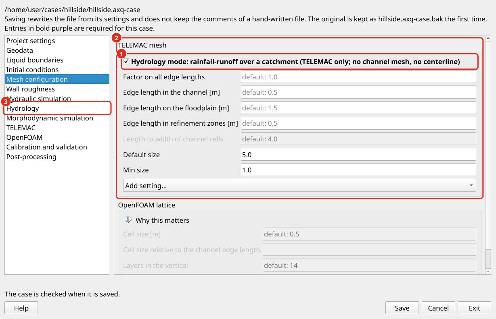
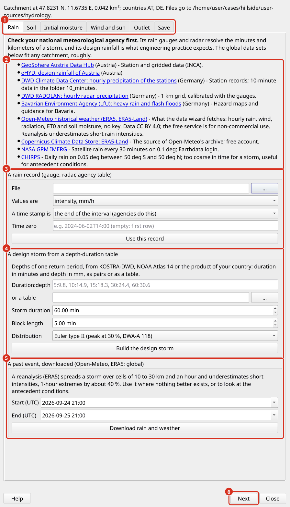

.. _help-hydrology:

Hydrology simulations
=====================

A hydrology simulation computes how rain on a catchment becomes runoff. Rain falls on every node of the mesh, part of it infiltrates into the soil, part of the surface water evaporates, and the rest flows over the terrain to the outlet. TELEMAC-2D solves the shallow water equations over the whole catchment, so that the hydrograph at the outlet, the water depths on the hillslopes and the flooded areas in the valley come from one model. This approach is called a hydrodynamic rainfall-runoff model, or rain on grid. It suits catchments up to some tens of square kilometers and flash floods in particular.

The hydrology mode is TELEMAC only. It is switched on in the case settings, with the check box *Hydrology mode* on the page *Mesh configuration* or on the page *Hydrology* (:ref:`case-hydrology`), and runs on the sub-tab *Simulations > Hydrology*.

   The case settings in hydrology mode. (1) The check box *Hydrology mode* at the top of the frame *TELEMAC mesh*: it gives the mesh near-equal triangles and grays out the settings the mode does not use, such as the length-to-width ratio of channel cells. (2) The edge lengths of the mesh: *Default size* outside the mesh zones; inside a zone its own ``Max Edge Length (m)``, else the edge length of its zone type. (3) The page *Hydrology* with rain, soil, wind and sun and the outlet; its switch and the check box *Hydrology mode* are one switch.

.. _hydrology-concept:

Concept
-------

**Infiltration after Green and Ampt.** The Green-Ampt model describes infiltration as a sharp wetting front that moves down into the soil (Green and Ampt 1911). Behind the front the soil is saturated, ahead of it the soil keeps its initial water content. The infiltration capacity :math:`f` [m/s] follows from Darcy's law across the wetted layer:

.. math::

   f = K_s \left(1 + \frac{\psi \,(\theta_s - \theta_i)}{F}\right)

where :math:`K_s` is the saturated hydraulic conductivity, :math:`\psi` the suction head at the wetting front, :math:`\theta_s` and :math:`\theta_i` the water contents at saturation and at the start, and :math:`F` the depth infiltrated so far. At the start of a storm :math:`F` is small and the capacity large, so that all rain infiltrates. With growing :math:`F` the capacity falls towards :math:`K_s`. When it falls below the rain intensity, water ponds on the surface and runoff begins (Mein and Larson 1973). Chu (1978) extended the ponding time to rain whose intensity changes from one interval to the next. The product :math:`a = \psi (\theta_s - \theta_i)` combines the suction head and the moisture deficit into one length, which is what aXqua passes to TELEMAC per mesh node, together with :math:`K_s`.

**The implementation in TELEMAC.** TELEMAC-2D has carried a Green-Ampt option since release 8.4 (``RAINFALL-RUNOFF MODEL : 3``), the integral form of Travert et al. (2022). The first implementation in TELEMAC is Broich et al. (2022). De Vos et al. (2024) tested the released form and found that ponded water does not infiltrate once the rain stops, and that the capacity rises when the rain intensifies after ponding. They recommend the explicit solution of Sadeghi et al. (2024) with the ponding time of Chu (1978). That revision is not part of a TELEMAC release, so aXqua generates the routine itself (``user_fortran/runoff_greenampt.f``) and offers three solutions:

.. list-table::
   :header-rows: 1
   :widths: 18 82

   * - ``green_ampt``
     - Infiltration capacity
   * - ``sadeghi``
     - The default, after de Vos et al. (2024): before ponding the exact capacity, so that all rain infiltrates; after ponding the explicit solution of Sadeghi et al. (2024) in the time since ponding. Ponded water keeps infiltrating after the rain. A node also ponds when water from upslope stands on it deeper than ``runon_depth``, which closes the gap that de Vos et al. name.
   * - ``exact``
     - The capacity :math:`K_s (1 + a/F)` on the infiltrated depth of each node, stepped in time. This is the form of Travert et al. without the term that causes the rise of the capacity, plus the infiltration of ponded water.
   * - ``travert``
     - The equations TELEMAC releases, for comparison.

The tests of aXqua compare the three solutions with the exact Green-Ampt solution under constant rain: the ``exact`` solution agrees to 0.2 %, ``sadeghi`` infiltrates 1 to 4 % less, and ``travert`` up to 9 % more. On a flat closed basin, TELEMAC with the generated routine and the reference of aXqua in Python give the same infiltrated depth to four digits, with the finite-volume and the finite-element kernel and on four processor cores.

**Rain, wind and sun.** The rain is one series for the whole catchment, held constant over each of its intervals. The wind of a weather series acts through TELEMAC's wind stress on water deeper than ``wind_threshold_depth`` (1 m), that is on ponds and lakes, not on the sheet flow of a hillslope. Evaporation is taken from the surface water at the FAO-56 reference evapotranspiration times the factor of open water, 1.05 for water less than 2 m deep (Allen et al. 1998). Soil water does not evaporate in this model, because the Green-Ampt model keeps no soil water budget that could give water back. During a storm both wind and evaporation are small against the rain; in the hours after it, evaporation empties the shallow ponds that a two-dimensional model otherwise keeps for ever.

**The numerical kernel.** Sheet flow on a hillslope is often thinner than the step of the bed between two neighboring nodes: a slope of 5 % over cells of 4 m is a step of 0.2 m under a film of millimeters. The classical hydrostatic reconstruction of the finite-volume kernel fails there. TELEMAC therefore offers the reconstruction of Chen and Noelle (2017), which its own rain-runoff validation case uses. A hydrology case runs on the finite-volume kernel (HLLC) with that reconstruction by default (``kernel: finite-volumes``). With the finite-element kernel, a test catchment kept 13 % of its rain on the surface 30 minutes after the storm, against 0.5 % with finite volumes.

.. _hydrology-data-setup:

Data setup
----------

A hydrology case needs a terrain model, the outline of the catchment, a rain series and a soil. Weather is optional. The *Data wizard...* on the sub-tab *Simulations > Hydrology* guides through the data, one tab for each kind:

.. _help-hydrology-wizard:

**The data wizard.** Every tab first lists the data portals of the national meteorological agency for the country of the catchment, and then the routes aXqua has. The national agency comes first for a reason: its rain gauges and radar resolve the minutes and kilometers of a storm, and its design rainfall is what engineering practice expects. Global data sets fill in where nothing else is at hand. Nothing is written into the case file before *Save*; the files a route produces go into ``user-sources/hydrology`` beside the case file, each with a provenance file that names the source, its license and the required attribution.

.. list-table::
   :header-rows: 1
   :widths: 20 80

   * - Tab
     - Routes
   * - Rain
     - A rain record (a table of time and rain in mm/h or mm per interval); a design storm from a depth-duration table of one return period, such as KOSTRA-DWD in Germany or NOAA Atlas 14 in the United States, distributed as Euler type II (DWA-A 118), alternating block (Chow et al. 1988) or one block; or a past event downloaded from the archive of Open-Meteo (ERA5 and ERA5-Land). A reanalysis underestimates short intensities, 1-hour extremes by about 40 %.
   * - Soil
     - A soil map with a zone number per polygon and a table of the zones; one texture class for the whole catchment; or the textures of ISRIC SoilGrids (250 m). Sealed surfaces from a layer of one's own or from the class built-up of ESA WorldCover (10 m).
   * - Initial moisture
     - A value, or the soil moisture of ERA5-Land (0 to 7 cm) at the start of the event.
   * - Wind and sun
     - The weather series, whether its wind is applied, and how evaporation is computed.
   * - Outlet
     - The condition of the outflow lines and the numerical kernel (see below).

   The data wizard. (1) One tab for each kind of data. (2) The portals of the national agencies for the countries of the catchment, then the global data sets. (3) A rain record of your own, from a gauge, a radar product or a table of the agency. (4) A design storm from the depth-duration table of one return period. (5) A past event, downloaded from Open-Meteo. (6) *Next* goes to the next tab; *Save* on the last tab writes the choices into the case file.

**Rain series.** A time stamp of a rain record is the start or the end of its interval. Agencies stamp the end: the rain of 12:00 to 13:00 is reported at 13:00, which is the default of ``rainfall_stamp``. The model's time zero is the start of the first interval, or ``rainfall_start`` for a series with dates.

The station files of the DWD Climate Data Center are read as they are downloaded. ``MESS_DATUM`` holds the date as one number (``2024060213``), and the rain columns are depths in mm whatever ``rainfall_units`` and ``rainfall_stamp`` say: ``R1`` is the hour before the stamp, ``RWS_10`` the 10 minutes before it, and ``RS`` the precipitation day of the DWD, which runs from 05:50 UTC of the date to 05:50 UTC of the next day (07:30 local time before April 2001). A daily value is therefore placed about six hours after midnight, and it is far too coarse to resolve a storm. Other dates written as one number, such as the ``time`` column of MeteoSwiss, are read as dates as well.

A value of -999, the code of the DWD for a missing measurement, or an empty cell is no measurement. In the rain it stays an interval of its own, simulated as dry, and the checkup names the gaps; in the weather series it is interpolated between the readings around it. A value of the DWD covers its own hour, 10 minutes or day, so an hour or a day that a file does not have at all is a gap as well, rather than being covered by the next value. A units row under the header and a sum at the end are left out. A row inside the data whose time cannot be read stops the import with that value, because its rain could not be placed in time.

**Soil parameters.** Where no measurements exist, Rawls et al. (1983) give mean Green-Ampt parameters for the eleven USDA texture classes:

.. list-table::
   :header-rows: 1
   :widths: 30 20 20 15 15

   * - Texture class
     - :math:`K_s` [mm/h]
     - :math:`\psi` [m]
     - :math:`\theta_s`
     - :math:`\theta_r`
   * - sand
     - 117.8
     - 0.050
     - 0.437
     - 0.020
   * - loamy sand
     - 29.9
     - 0.061
     - 0.437
     - 0.036
   * - sandy loam
     - 10.9
     - 0.110
     - 0.453
     - 0.041
   * - loam
     - 3.4
     - 0.089
     - 0.463
     - 0.029
   * - silt loam
     - 6.5
     - 0.167
     - 0.501
     - 0.015
   * - sandy clay loam
     - 1.5
     - 0.219
     - 0.398
     - 0.068
   * - clay loam
     - 1.0
     - 0.209
     - 0.464
     - 0.155
   * - silty clay loam
     - 1.0
     - 0.273
     - 0.471
     - 0.039
   * - sandy clay
     - 0.6
     - 0.239
     - 0.430
     - 0.109
   * - silty clay
     - 0.5
     - 0.292
     - 0.479
     - 0.056
   * - clay
     - 0.3
     - 0.316
     - 0.475
     - 0.090

:math:`\theta_s` is the total porosity and :math:`\theta_r` the residual water content. The water content at the start of the event is the most sensitive of all inputs: a soil near saturation takes up little rain. It is given as ``initial_water_content`` or per zone; without it, aXqua assumes an effective saturation of 0.3 and the checkup says so.

.. _hydrology-weather:

Wind and evaporation
--------------------

The weather series is a table of time and any of the columns ``wind_speed_10m``, ``wind_direction_10m`` (the direction the wind comes from), ``shortwave_radiation`` [W/m²], ``temperature`` [°C], ``relative_humidity`` [%], ``et0`` [mm/h] and ``evaporation`` [mm/h]. Its time stamps follow ``rainfall_stamp``. With ``wind: true``, aXqua turns speed and direction into the two components of the wind and writes them for TELEMAC (``atmosphere.txt``); the drag coefficient follows Flather (``wind_formula``).

``evaporation`` takes one of four values: ``none``; ``et0``, the column et0 times ``open_water_factor``; ``penman``, the hourly FAO-56 Penman-Monteith equation from radiation, temperature, humidity and wind at the location of the catchment (Allen et al. 1998, eq. 53); and ``series``, the column evaporation as it is. The evaporation never takes more than the surface water that is there after infiltration.

.. _hydrology-outlet:

Boundaries and outlet
---------------------

**The outline is a wall.** The outline of a hydrology case is the drainage divide of the catchment. Along a divide, a solid wall is not an approximation but the definition of the divide: no surface water crosses it. Where the outline is not the divide, the terrain slopes out of the domain under the wall, and in the model the water collected upslope ponds against it. The hydrology checkup finds these places (:ref:`preprocessing-checkup`).

**The outlet.** Water leaves through the outflow lines of ``boundaries.liquid_boundaries``, drawn on the outline across the outlet of the catchment. Inflow lines are optional and carry the hydrographs of catchments upstream that are not part of the model. ``hydrology.outlet_condition`` sets what the outflow lines prescribe:

.. list-table::
   :header-rows: 1
   :widths: 18 82

   * - Outlet
     - Meaning
   * - ``normal_depth``
     - The default. TELEMAC's stage-discharge curve Z(Q) of each outflow line: the level at which the section of that line conveys the discharge in uniform flow, from the terrain model, the bed roughness of the section and the bed slope upstream of it. A measured rating curve (``boundaries.stage_discharge``) takes its place where one exists.
   * - ``free``
     - Nothing is prescribed: depth and velocity have no gradient across the line. This holds only where the flow leaves supercritical, at a steep and smooth outlet.
   * - ``elevation``
     - The fixed level ``boundaries.prescribed_elevation``, for a catchment that drains into a lake or a large river.
   * - ``overfall``
     - No water is held at the outflow lines: the water leaves as over a brink, at critical flow at most, and none comes back. For an outline that is not a divide but the lower edge of a field, a terrace or a bank, over which the terrain falls away.

A free outlet appears to be the natural choice, since zero gradient on a uniform slope is normal flow. In the tests of aXqua it was not: a channel at 2 % with a Manning coefficient of 0.03 runs a few centimeters deep near critical flow, and its free outlet filled up into a standing pond with the finite-volume kernel and became unstable with the finite-element kernel, where TELEMAC reported velocities entering through the free boundary. ``normal_depth`` drained the equilibrium discharge :math:`Q = i A` of the same catchment to 0.01 % with both kernels.

**A field instead of a catchment.** A field, a plot or a terrace is often the object of a study, and its outline is no divide: water leaves it over whole edges, wherever the terrain falls away beyond them. These edges are outflow lines, and ``overfall`` is their condition. TELEMAC sets the depth at a node of a prescribed level to the level minus the bed elevation, and to zero where that is negative. aXqua therefore prescribes a level 1 m below the lowest node of the mesh, and every node of the lines gets a depth of zero. The finite-volume kernel takes that depth as a dry state outside the line, so water flows out of a wet cell the way it flows into dry land, and no water can come in. The finite-element kernel holds the nodes of the lines dry, which on the example field also let no water in. A Z(Q) curve does not fit such an edge, because one level for an edge that runs across the slope is the level of its lowest point only. The free outlet copies the state inside the domain to the outside, so water flows in wherever the velocity at the edge points into the domain. On the arable field of the example case ``example-agrohydrology``, a free outlet took in 2.7 m³/s through the lower edge of the field 16 minutes after the runoff began. The other edges of a field stay walls, so the field receives no run-on from its neighbors. The hydrology checkup shows whether any of its own water still crosses a wall.

**Roughness of the outlet.** The level of ``normal_depth`` depends on the roughness of the outlet section. With Manning's equation, :math:`h \sim (n Q / (b \sqrt{S}))^{3/5}`, so that an error of 20 % in :math:`n` changes the depth at the outlet by about 12 %. The disturbance fades upstream over a length of about :math:`h/S`: 50 m for a depth of 0.5 m on a slope of 1 %, 1 km for a depth of 1 m on a slope of 0.1 %. The outlet therefore belongs a few such lengths downstream of where results are read. The roughness is that of the roughness zones at the outlet, or of ``friction.default_law`` and ``default_coefficient``. The keyword ``LAW OF FRICTION ON LATERAL BOUNDARIES`` plays no part: TELEMAC applies it to solid walls only.

**Why not a depth from the local velocity.** A condition that sets the depth at each outlet node from the local velocity with Manning's equation prescribes a depth that goes to zero wherever the velocity is small, which drains ponded water at the start and during the recession, and it feeds the velocity back into the prescribed depth, which oscillates in subcritical flow. The Z(Q) curve of the whole section has the same physics without that feedback.

.. _hydrology-run:

Run and results
---------------

The preprocessing builds a hydrology case like any TELEMAC case (:doc:`preprocessing`): the mesh of near-equal triangles, the soil fields of every node in the geometry file, the boundary conditions, the forcing files, the generated runoff routine and the steering file ``hydrology2d.cas``. The run starts dry and lasts until ``drain_time`` after the last rain. *Submit* on the sub-tab *Simulations > Hydrology* runs it as a job.

   The sub-tab *Hydrology* of the tab *Simulations*. (1) The sub-tab. (2) *Build* prepares the case, *Submit* runs it as a job. (3) The data of the case, with the position and the area of the catchment. (4) The findings of the hydrology checkup. (5) *Data wizard...* opens the wizard (figure above); *Check* runs the checkup again, including the analysis of the terrain model.

After the run, aXqua writes into ``postprocessing/hydrology``:

* ``hydrograph.csv`` and ``hydrograph.png``: the rain above, the discharge at the outlet below, over one time axis;
* ``water-balance.csv``: rain, inflow, outflow, infiltrated and evaporated volumes, the water left on the catchment, TELEMAC's mass error, the runoff coefficient (outflow over rain) and the peak discharge with its time.

The volumes come from TELEMAC's own water balance and from the line ``AXQUA HYDROLOGY`` that the generated routine writes into the listing. On the test catchments the balance closes to 0.000 % of the rain. *Load results* adds the water depth, the velocity, the infiltrated depth and TELEMAC's high water mark and highest velocity of the run to QGIS. The map of the water depth shows water from 1 mm on, because the sheet flow of a hillslope is millimeters deep; a river case starts at 1 cm. The threshold is ``hydrodynamics.wet_depth``, which a case may set to another value. TELEMAC itself records its maxima only where the water is deeper than 1 cm (``preres_telemac2d.f``), so that on a hillslope the high water mark and the highest velocity show the furrows, channels and ponds, and not the sheet flow between them.

**References**

* Allen, R. G., Pereira, L. S., Raes, D. and Smith, M. (1998). Crop evapotranspiration. FAO Irrigation and Drainage Paper 56. FAO, Rome.
* Broich, K., Obermaier, T., Alcamo, L. and Disse, M. (2022). TELEMAC as a hydrodynamic rainfall-runoff model: New extension using the Green-Ampt-infiltration. Proceedings of the XXVIIIth TELEMAC User Conference, Paris-Saclay, 143-145. https://hdl.handle.net/20.500.11970/110848
* Chen, G. and Noelle, S. (2017). A new hydrostatic reconstruction scheme based on subcell reconstructions. SIAM Journal on Numerical Analysis, 55(2), 758-784.
* Chow, V. T., Maidment, D. R. and Mays, L. W. (1988). Applied Hydrology. McGraw-Hill, New York.
* Chu, S. T. (1978). Infiltration during an unsteady rain. Water Resources Research, 14(3), 461-466.
* De Vos, L. F., Broich, K., Wirthensohn, M. and Rüther, N. (2024). Revised implementation of the Green-Ampt infiltration method in TELEMAC-2D. Proceedings of the XXXth TELEMAC User Conference, Chambéry. https://hdl.handle.net/20.500.11970/114347
* Green, W. H. and Ampt, G. A. (1911). Studies on soil physics. The Journal of Agricultural Science, 4(1), 1-24.
* Mein, R. G. and Larson, C. L. (1973). Modeling infiltration during a steady rain. Water Resources Research, 9(2), 384-394.
* Rawls, W. J., Brakensiek, D. L. and Miller, N. (1983). Green-Ampt infiltration parameters from soils data. Journal of Hydraulic Engineering, 109(1), 62-70.
* Sadeghi, S. H., Loescher, H. W., Jacoby, P. W. and Sullivan, P. L. (2024). A simple, accurate, and explicit form of the Green-Ampt model to estimate infiltration, sorptivity, and hydraulic conductivity. Vadose Zone Journal, 23(4).
* Travert, J.-P., Taccone, F. and Bacchi, V. (2022). Modelling runoff for extreme rainfall events on large catchments using TELEMAC-2D. Proceedings of the XXVIIIth TELEMAC User Conference, Paris-Saclay, 131-139.
