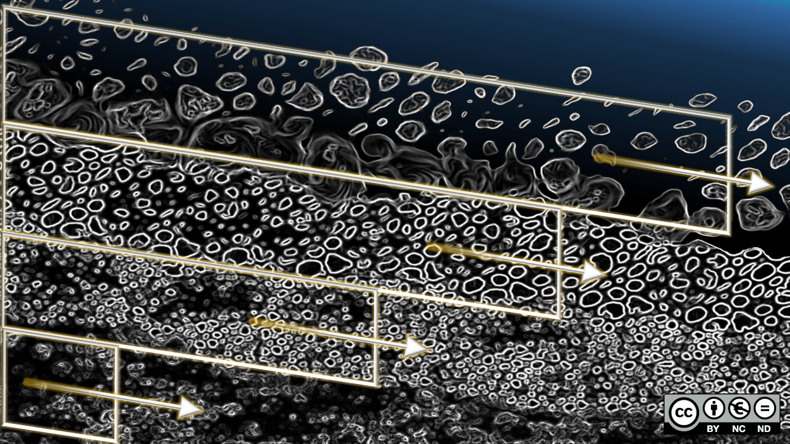
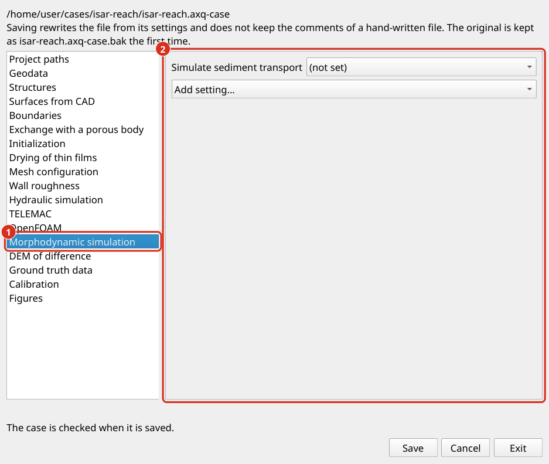
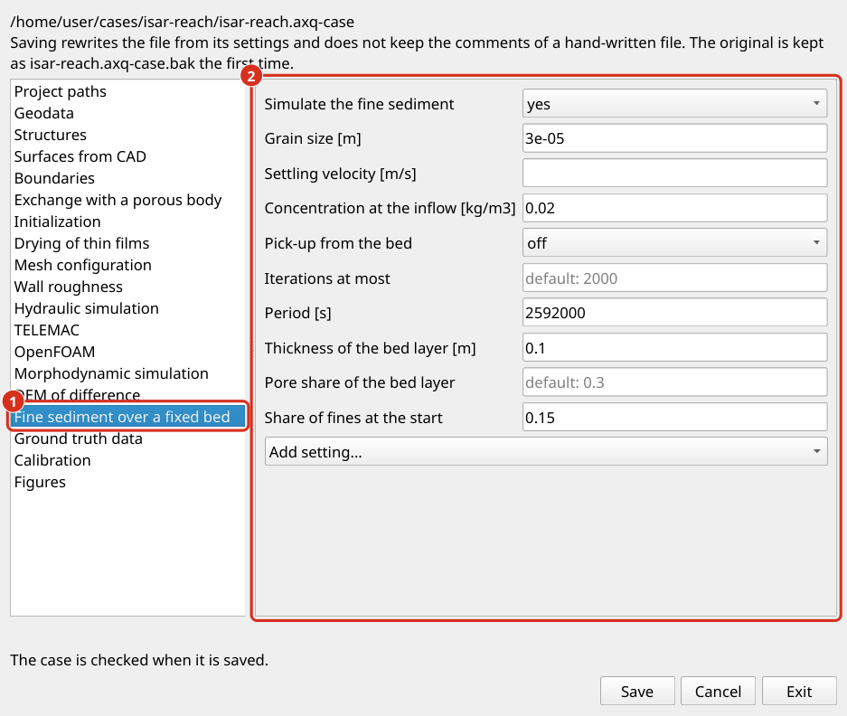
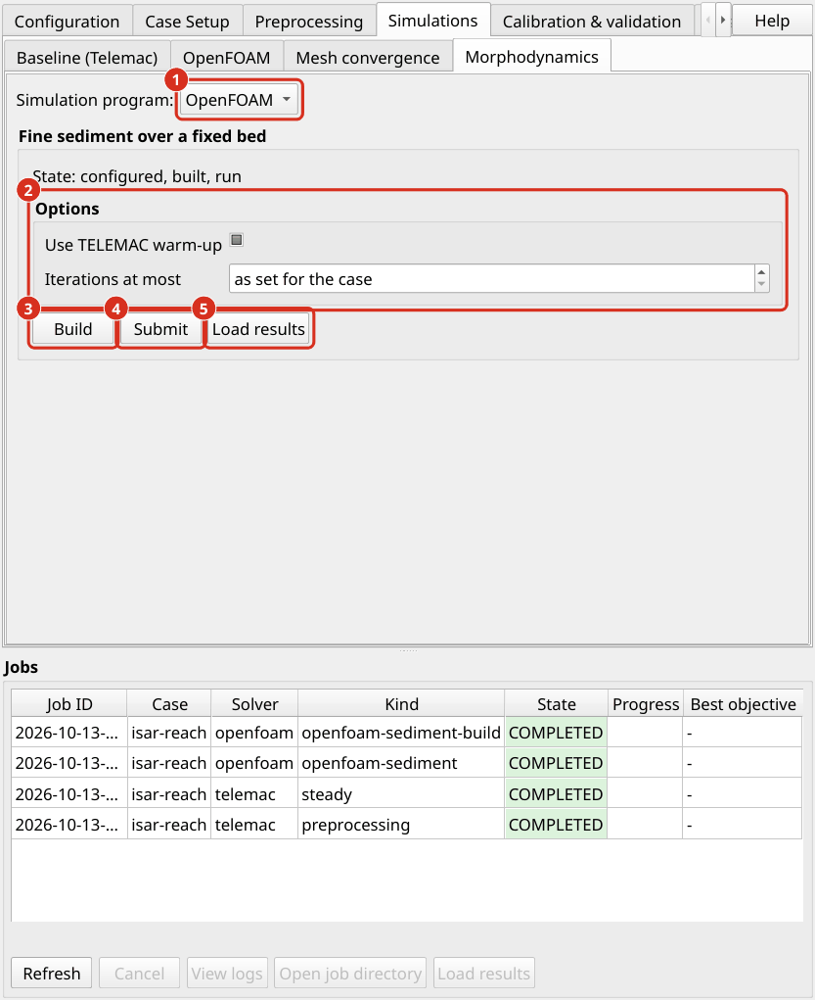

.. _help-morphodynamics:

Morphodynamic simulations
=========================

A morphodynamic simulation computes how flowing water moves sediment and how the riverbed changes as a result. It extends a hydraulic simulation: in every time step, the flow moves sediment, the bed elevation is updated, and the changed bed in turn alters the flow.

aXqua offers two simulations, which answer different questions. The coupled simulation with TELEMAC and GAIA computes a riverbed that moves (:ref:`help-morphodynamics-telemac`). The simulation with OpenFOAM computes fine sediment that passes over a riverbed which stays in place (:ref:`help-morphodynamics-openfoam`).

.. _morphodynamics-concept:

Concept
-------

**Transport modes.** Flowing water moves sediment in two ways. **Bedload** consists of grains that roll, slide or jump along the bed. It is the dominant mode for gravel and coarser material. **Suspended load** consists of finer grains that turbulence keeps afloat in the water column. Simulating both modes is computationally expensive, so that only the dominant mode should be activated:

* a gravel or cobble bed with less than about 5 to 10 % sand: bedload only;
* sediment that is generally finer than 1 mm, as in reservoirs: suspended load only;
* mixtures with a substantial sand content: both modes;
* cohesive sediment (finer than 0.06 mm): suspended load is required.

**Start of motion.** A grain starts to move when the shear stress that the flow exerts on the bed exceeds a critical value. This threshold is expressed by the dimensionless critical Shields parameter, which has to be defined for each grain size class. Because it is uncertain, it is a typical calibration parameter.

**Bed change.** The bed elevation changes wherever the sediment transport rate changes along the flow path. If more sediment enters a location than leaves it, sediment deposits and the bed rises. In the opposite case, the bed erodes. This sediment mass balance is called the Exner equation (Exner 1925).

**Active layer.** Only the uppermost layer of the riverbed takes part in sediment transport at a given moment. This layer is called the active layer. It supplies the sediment that is eroded and receives the sediment that is deposited. Its thickness is a multiple of the characteristic grain diameter. The layers below form the substratum, which is only reached when the active layer is eroded. The distinction matters in rivers with an armored bed, where a coarse surface layer protects finer sediment underneath (Hirano 1971): as long as the armor layer is intact, little sediment moves, and once it breaks, the finer substratum is rapidly eroded.

   The active layer at the surface of the riverbed is in contact with the flow. The substratum layers below can have different grain size compositions. Figure by Schwindt (`hydro-informatics.com <https://hydro-informatics.com>`_, CC BY-NC-ND), conceptually after du Boys (1879) and Church and Haschenburger (2017).

**Fine sediment in a stable bed.** Between floods, the gravel of a riverbed does not move, and two terrain surveys show no bed change. The bed nevertheless changes: sand and silt that the flow carries settle onto it and into its pores, and faster flow removes them again. The quantity that describes this change is the share of fine sediment in the bed material, not the bed elevation.

**Reference data.** A model of a moving bed is assessed against measured bed changes, which are obtained as the difference of two terrain surveys (:ref:`case-morphodynamics`). A model of fine sediment over a stable bed is assessed against the share of fines in bed samples that were taken at two dates.

.. _help-morphodynamics-telemac:

TELEMAC-GAIA Setup
------------------

`GAIA <http://www.opentelemac.org/>`_ is the sediment transport module of TELEMAC. When ``morphodynamics.enabled`` is set in the case file, the preprocessing writes a GAIA steering file (``gaia.cas``) next to the TELEMAC model and couples it to the hydraulic simulations.

   Sediment transport is switched on in the case editor (*Edit case...* on the *Case Setup* tab). (1) The block *Morphodynamic simulation*. (2) Its settings, of which further ones are added with *Add setting...*.

.. list-table::
   :header-rows: 1
   :widths: 34 66

   * - Entry in ``morphodynamics``
     - Meaning
   * - ``bedload``, ``suspended_load``
     - Transport modes to be simulated.
   * - ``sediment_classes``
     - One entry per grain size class with ``diameter`` [m], ``density`` [kg/m³] and the critical Shields parameter ``shields``.
   * - ``bedload_formula``
     - Number of the bedload transport formula in GAIA (1 is the formula of Meyer-Peter and Müller).
   * - ``active_layer_thickness``
     - Thickness of the active layer [m]. A common choice is three times the diameter of the coarse grains.
   * - ``bed_layers``
     - Number of substratum layers.
   * - ``slope_effect``, ``friction_angle``
     - Deflection of the bedload on a laterally inclined bed, and the angle of repose of the sediment [degrees].
   * - ``secondary_currents``
     - Deflection of the bedload by the spiral flow in river bends.
   * - ``prescribed_solid_discharges``
     - Sediment supply at each open boundary.
   * - ``morphological_factor``
     - Factor by which the bed change is accelerated relative to the flow. A value of 10 means that one simulated hour represents ten hours of bed change. Use values above 1 with care, and only for slowly varying discharges.

Significant bed changes occur during floods. A morphodynamic simulation is therefore usually run with a discharge time series. Define the time series under ``boundaries.inflow``, enable ``morphodynamics``, repeat the preprocessing and start the unsteady run (:ref:`hydraulics-hotstarts`):

.. code-block:: text

   axqua <case-file>
   axqua submit <case-file> --kind unsteady

The GAIA results are written next to the hydraulic results. The variable for the bed change is the cumulated bed evolution.

.. note::

   The grain size classes are entered by hand. The automatic derivation of the classes from measured grain size distributions is not yet available in this version.

.. _help-morphodynamics-openfoam:

OpenFOAM Setup
--------------

With OpenFOAM, aXqua simulates **fine sediment over a riverbed that stays in place**. The simulation shows where sand or silt that the flow carries settles onto the bed, and where the flow picks it up again. The bed elevation does not change. Use this simulation where surveys show no measurable bed change while the share of fine sediment in the bed differs from one sampling date to the next. Use TELEMAC and GAIA where the bed moves.

The simulation uses the solver ``sediDriftFoam2`` of Nils Reidar B. Olsen (`documentation <https://www.pvv.ntnu.no/~nilsol/sediDriftFoam/>`_). The solver computes a steady, three-dimensional flow below a fixed water surface, and the concentration of one grain size in that flow. The grains travel with the water, sink with their settling velocity and are mixed by turbulence. At the bed, two processes exchange sediment:

* **Settling.** Grains reach the bed at the rate *settling velocity × concentration in the cell at the bed*.
* **Pick-up.** The flow removes grains at a rate that follows from the bed shear stress, with the formulas of van Rijn (1984a, 1984b). The critical shear stress, at which grains start to move, is corrected for the slope of the bed (Dey 2003).

The solver is not part of OpenFOAM. It is built by the OpenFOAM installation of aXqua (:ref:`install-openfoam`), and it runs in one process.

**Requirements.** The simulation needs the steady 2D result of the case (:ref:`hydraulics-dry-runs`), because the water surface of that result is the upper limit of the three-dimensional mesh. The mesh itself is the mesh of the OpenFOAM model in the mode ``rigid-lid`` (:ref:`preprocessing-openfoam-choices`), whatever mode the hydraulic OpenFOAM simulation of the case uses. Its cell size (``openfoam.cell_size`` or ``openfoam.cell_size_factor``) decides how long the simulation takes.

**Settings.** The simulation is defined in the block ``fine_sediment`` of the case file, which is the block *Fine sediment over a fixed bed* in the case editor:

.. code-block:: yaml

   fine_sediment:
     enabled: true
     grain_size: 0.00003          # [m], coarse silt
     inflow_concentration: 0.02   # [kg/m3], which is 20 mg/l
     pick_up: off
     period: 2592000              # [s], 30 days
     layer_thickness: 0.1         # [m]
     initial_fraction: 0.15

.. list-table::
   :header-rows: 1
   :widths: 30 70

   * - Entry in ``fine_sediment``
     - Meaning
   * - ``grain_size``
     - Diameter of the grains [m]. The simulation carries one grain size, up to 0.002 m.
   * - ``fall_velocity``
     - Settling velocity of the grains in still water [m/s]. If empty, it is computed from the grain size (Ferguson and Church 2004).
   * - ``inflow_concentration``
     - Sediment concentration of the water that enters the model [kg/m³]. One number applies to all inflow lines. To give each line its own value, name the lines, for example ``{inlet-1: 0.02, inlet-2: 0}``. The build lists the names of the inflow lines with their discharges in its log.
   * - ``pick_up``
     - What the bed returns to the flow. ``suspended`` uses the reference concentration of van Rijn (1984b) and ``bedload`` his bedload formula (1984a). Both assume a bed that consists of the fine sediment. ``off`` means that the bed only takes sediment up.
   * - ``roughness``
     - Roughness height with which the bed shear stress is computed [m]. If empty, the median roughness of the wetted bed is used (``geodata.roughness_table``). The simulation uses one roughness for the whole bed.
   * - ``bottom_layer``
     - Thickness of the cells at the bed [m]. If empty, it is the smallest water depth of the model divided by the number of layers.
   * - ``iterations``
     - Largest number of iterations. The simulation ends earlier when it has converged.
   * - ``period``
     - Time over which the computed rates act [s]. If empty, the result contains rates only.
   * - ``layer_thickness``, ``porosity``, ``initial_fraction``
     - The bed layer for which the share of fines is reported: its thickness [m], the share of pores between its coarse grains, and the share of fines in its dry mass at the beginning of the period.

   The fine sediment simulation is defined in the case editor (*Edit case...* on the *Case Setup* tab). (1) The block *Fine sediment over a fixed bed*. (2) Its settings, of which further ones are added with *Add setting...*.

**Choice of the pick-up.** The formulas of van Rijn describe a bed of sand, from which the flow can remove as many grains as its shear stress allows. A gravel bed holds fine sediment only in its pores, so that these formulas overestimate the removal by orders of magnitude. For fine sediment over a gravel bed, set ``pick_up: off``. The result then shows where fine sediment settles and how much, and the bed shear stress in the result shows where the flow is able to remove it again.

**Simulation.** Go to the tab *Simulations*, sub-tab *Morphodynamics*, and select the simulation program *OpenFOAM*. Click *Build* in the box *Fine sediment over a fixed bed*, then *Submit*. Both can be clicked one after the other, because the simulation waits for its build, and the build waits for a steady 2D simulation that is still running. The progress display counts iterations. On a mesh of 11,000 cells, the simulation takes less than one minute. In a terminal, the commands are:

.. code-block:: text

   axqua submit <case-file> --kind openfoam-sediment-build
   axqua submit <case-file> --kind openfoam-sediment

   The sub-tab *Morphodynamics* of the tab *Simulations* with the simulation program *OpenFOAM*. (1) The choice of the simulation program. (2) The options: the warm-up for the build, and the largest number of iterations for the simulation. (3) *Build* creates the model. (4) *Submit* starts the simulation. (5) *Load results* adds the bed with its fine sediment to the map.

**Results.** *Load results* adds the layer *Fine sediment at the bed* to the map. It holds one polygon for every column of cells, with the attributes listed below, and is colored by the change of the share of fines, or by the net rate if the case defines no period. The file is ``axqua-case/openfoam-sediment/fine-sediment-bed.gpkg``. The three-dimensional fields of velocity and concentration can be opened in ParaView through ``case.foam`` in the same folder.

.. list-table::
   :header-rows: 1
   :widths: 22 18 60

   * - Attribute
     - Unit
     - Meaning
   * - ``depth``
     - m
     - Water depth.
   * - ``velocity``
     - m/s
     - Flow velocity in the cell at the bed.
   * - ``shear``, ``shear_crit``
     - N/m²
     - Bed shear stress and its critical value for the grain size, as the solver computes them.
   * - ``transport``
     - \-
     - Transport parameter of van Rijn: the excess of the shear stress over its critical value, divided by the critical value. Zero where the flow cannot move the grains.
   * - ``conc_bed``
     - kg/m³
     - Sediment concentration in the cell at the bed.
   * - ``settling``, ``pick_up``, ``net``
     - kg/(m² day)
     - Mass that settles onto the bed, mass that the flow picks up, and their difference, per bed area and day. A positive ``net`` means that the bed takes up fine sediment.
   * - ``mass``
     - kg/m²
     - Mass of fine sediment that the bed takes up during the period.
   * - ``fraction``, ``change``
     - \-
     - Share of fines in the dry mass of the bed layer at the end of the period, and its change since the beginning.
   * - ``limit``
     - \-
     - -1 where the bed layer has given off all its fines, 1 where its fines no longer fit into its pores.

The last four attributes are only present if the case defines a ``period``. They follow from a mass balance of the bed layer. The layer holds coarse grains with a mass of 2650 kg/m³ × ``layer_thickness`` × (1 − ``porosity``) per bed area, which stay in place. All fine sediment that the bed takes up is added to the layer, and the layer cannot give off more fines than it holds. The density of the grains is 2650 kg/m³ throughout, because the formulas of the solver contain this value.

Together with the layer, aXqua writes a sediment budget (``fine-sediment-budget.json``) and prints it in the log of the job: the mass of sediment that enters the model per second, the mass that leaves it, and the masses that settle and are picked up over the whole bed. In a converged simulation, what enters equals what leaves plus what the bed takes up. If more than 2 % remain unexplained, the result says so, and ``iterations`` has to be increased.

**Limits.** The following limits result from the solver and from the fixed water surface. They are part of every result:

* *The water surface is fixed.* It is the water surface of the 2D result and cannot respond to the three-dimensional flow. Where it steps by more than the local water depth within two cells, as at a riffle of a shallow reach, the flow below it becomes too fast, and the build refuses the case. With ``openfoam.allow_stepped_lid: true``, the case is built nevertheless, and the result states how large the steps are and how fast the fastest cell is. Read the bed near such steps with care.
* *The bed does not move.* The solver can also lower and raise the bed. aXqua does not use this function, because the solver then enforces a minimum water depth by lowering the bed and treats the ends of the model as the ends of a laboratory flume.
* *One grain size and one roughness.* Sediment mixtures and roughness zones are not represented.
* *Steep bed.* Where the bed rises steeply within one cell, the solver computes a bed shear stress that is too high. The build reports the share of such cells and refuses a mesh on which the computation would fail. Smaller cells reduce the share.
* *Steady flow in one process.* A discharge time series cannot be simulated, and the simulation does not run in parallel.

References
~~~~~~~~~~

Church, M., and Haschenburger, J. K. (2017). "What is the 'active layer'?" *Water Resources Research*, 53, 5-10. `doi:10.1002/2016WR019675 <https://doi.org/10.1002/2016WR019675>`_

Dey, S. (2003). "Threshold of sediment motion on combined transverse and longitudinal sloping beds." *Journal of Hydraulic Research*, 41(4), 405-415. `doi:10.1080/00221680309499985 <https://doi.org/10.1080/00221680309499985>`_

Du Boys, P. (1879). "Etudes du régime du Rhône et l'action exercée par les eaux sur un lit à fond de graviers indéfiniment affouillable." *Annales des Ponts et Chaussées*, 5(18), 141-195.

Exner, F. M. (1925). "Über die Wechselwirkung zwischen Wasser und Geschiebe in Flüssen." *Akademie der Wissenschaften in Wien, math.-naturw. Klasse, Sitzungsberichte, Abt. IIa*, 134, 165-203.

Ferguson, R. I., and Church, M. (2004). "A simple universal equation for grain settling velocity." *Journal of Sedimentary Research*, 74(6), 933-937. `doi:10.1306/051204740933 <https://doi.org/10.1306/051204740933>`_

Hirano, M. (1971). "River-bed degradation with armoring." *Proceedings of the Japan Society of Civil Engineers*, 1971(195), 55-65. `doi:10.2208/jscej1969.1971.195_55 <https://doi.org/10.2208/jscej1969.1971.195_55>`_

Van Rijn, L. C. (1984a). "Sediment transport, part I: Bed load transport." *Journal of Hydraulic Engineering*, 110(10), 1431-1456. `doi:10.1061/(ASCE)0733-9429(1984)110:10(1431) <https://doi.org/10.1061/(ASCE)0733-9429(1984)110:10(1431)>`_

Van Rijn, L. C. (1984b). "Sediment transport, part II: Suspended load transport." *Journal of Hydraulic Engineering*, 110(11), 1613-1641. `doi:10.1061/(ASCE)0733-9429(1984)110:11(1613) <https://doi.org/10.1061/(ASCE)0733-9429(1984)110:11(1613)>`_
