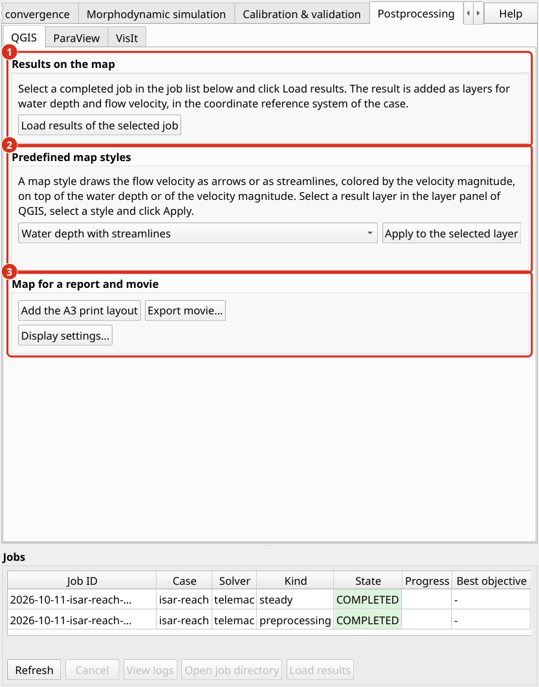
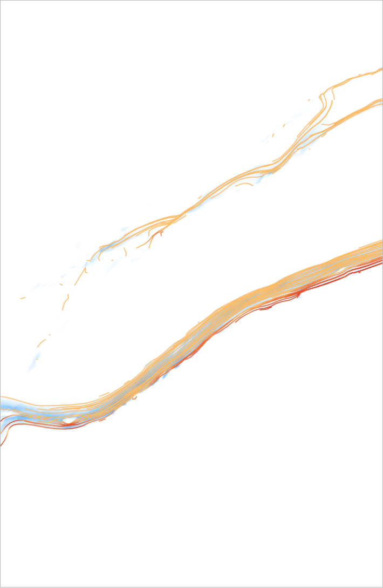
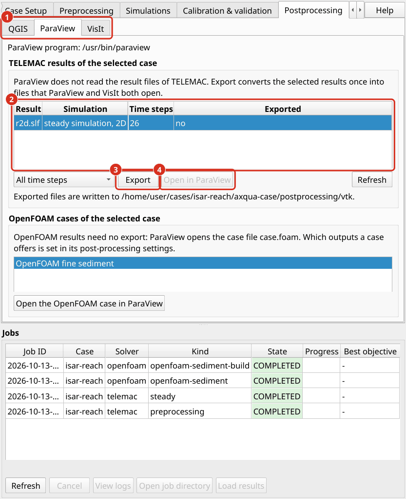

.. _help-postprocessing:

Postprocessing
==============

Postprocessing turns simulation results into maps, figures and tables. Depth-averaged results are best presented as maps in QGIS. Three-dimensional results require ParaView or VisIt (:doc:`../installation/postprocessors`).

.. admonition:: Watch aXua postprocessing basics on YouTube
   :class: tip dropdown

   .. raw:: html

      

        <iframe
          src="https://www.youtube.com/embed/gK83Q8bJCHI"
          title="TELEMAC 2D simulations with aXqua: dry start"
          loading="lazy"
          allow="accelerometer; autoplay; clipboard-write; encrypted-media; gyroscope; picture-in-picture; web-share"
          referrerpolicy="strict-origin-when-cross-origin"
          allowfullscreen>
        </iframe>
      

   `Open the tutorial on YouTube <https://youtu.be/2qWOA7l5xeg>`_.

.. _help-postprocessing-qgis:

QGIS map generation
-------------------

**Load results.** In the job list below the tabs, select a completed job and click *Load results*. The result layers are added to the QGIS project in a group that is named after the job. aXqua does not copy any files. The layers refer to the result files at their location in ``axqua-case/``. The map shows the last time step of the result, which for a steady simulation is the steady state. The *Temporal Controller* panel of QGIS selects another time step, for example of a simulation with a varying discharge.

   The tab *Postprocessing*, sub-tab *QGIS*. (1) Loading the results of the selected job. (2) The predefined map styles. (3) The print layout, the movie export and the display settings.

TELEMAC results are loaded as a mesh layer with two predefined styles:

* **Water depth** is drawn from white over light blue to dark blue. Water that is shallower than the minimum water depth is transparent, so that the map shows the area in which water actually flows (:ref:`plugin-profile`).
* **Flow velocity** is drawn as a color fill of the velocity magnitude, from yellow (slow) to purple (fast), with dark arrows in the flow direction. The color scale ends at the upper limit of the profile, and aXqua reports when a result exceeds it. The arrows stand on a regular grid of the map, so that their number does not depend on the mesh, and no arrow is drawn where the water stands.

**Predefined map styles.** The tab *Postprocessing*, sub-tab *QGIS*, offers four map styles that combine the flow direction with a second quantity in one layer. Select a result layer in the layer panel of QGIS, select a style and click *Apply to the selected layer*:

.. list-table::
   :header-rows: 1
   :widths: 36 64

   * - Map style
     - Content
   * - Water depth with streamlines
     - The water depth in blue. On top of it, streamlines that follow the flow direction and are colored by the velocity magnitude, from light orange (slow) to dark red (fast).
   * - Water depth with velocity arrows
     - The water depth in blue with arrows in the flow direction, colored by the velocity magnitude in the same way.
   * - Velocity magnitude with streamlines
     - The velocity magnitude from yellow to purple with dark streamlines.
   * - Velocity magnitude with arrows
     - The velocity magnitude from yellow to purple with dark arrows. This is the style in which the velocity layer is loaded.

**Maps of a case.** Which layers *Load results* adds, and whether one of these map styles is applied at once, is set for each case in its settings (*Open case settings...* on the *Case Setup* tab, page *Post-processing*): ``postproc.telemac_maps`` selects the maps of a TELEMAC result (``depth``, ``velocity``, ``free-surface``; water depth and velocity by default), and ``postproc.map_style`` names a map style that is applied to the water depth layer of every loaded TELEMAC result (``depth-streamlines``, ``depth-arrows``, ``velocity-streamlines``, ``velocity-arrows``; none by default).

A streamline is a line that is tangent to the velocity at each of its points. Streamlines therefore show flow paths, recirculation zones and the division of the discharge among several channels more clearly than arrows. Neither arrows nor streamlines are drawn where the velocity is below 0.05 m/s. All other properties of the layers are changed in the QGIS layer properties as usual (*Layer Properties > Symbology*).

   A steady result in the map style *Water depth with streamlines*: the water depth in blue and the streamlines colored by the velocity magnitude.

**Print layout.** *aXqua > Add the default A3 print layout* creates a map layout for the current map extent. It contains the map, a north arrow, an arrow in the flow direction, a scale bar and a legend. Complete the legend and export the layout as PDF or image from the QGIS layout manager.

**Movies.** For a simulation with a varying discharge, *aXqua > Export movie* renders one image per output time step of a result variable and combines the images into a video file. The movie uses the current map extent and layer styles. The encoding requires the program ``ffmpeg``. If it is not installed, the images are kept, and aXqua shows the command with which they can be encoded later.

**Export.** The result layers are ordinary QGIS layers. They are exported to other formats with the export functions of QGIS, for example to a raster of water depths.

**Tables.** The evaluations of a run, such as the discharges at the boundaries and the wetted area, are stored as CSV files next to the results (:ref:`hydraulics-dry-runs`). With ``geodata.control_sections``, aXqua additionally computes the discharge through each cross section of that layer from the result. The cross sections can be moved in QGIS and evaluated again without repeating the simulation.

.. _help-postprocessing-paraview:

ParaView
--------

ParaView is suited for the interactive inspection of results in three dimensions. It opens an OpenFOAM model directly and a TELEMAC result after an export.

.. _export-telemac-results:

**Export of TELEMAC results.** ParaView and VisIt do not read the result format of TELEMAC (SELAFIN). aXqua therefore converts a result once into the VTK format, which both programs read. On the tab *Postprocessing > ParaView*, the table lists the TELEMAC results of the selected case with their number of time steps. Select one or several results, choose between all time steps and the last time step only, and click *Export*. Without a selection, all results are exported. The conversion of one time step takes about one second for a mesh of 230,000 nodes. The same export serves ParaView and VisIt, and is repeated after a simulation was run again: the column *Exported* states whether the exported files are older than the result.

The exported files are written to the folder ``axqua-case/postprocessing/vtk/``. Each result has a file ``<result>.pvd`` for ParaView, a file ``<result>.visit`` for VisIt, and a folder with one file per time step. In a terminal, the export is:

.. code-block:: text

   axqua export <case-file>                              # all results of the case
   axqua export <case-file> --result r2d.slf --frames last
   axqua export <case-file> --list                       # what the case has, and what is exported

   The tab *Postprocessing*, sub-tab *ParaView*. (1) The sub-tabs of the three programs. (2) The TELEMAC results of the active case. (3) *Export* converts the selected results. (4) *Open in ParaView* starts the program with the exported result. The sub-tab *VisIt* has the same structure.

What the exported files contain:

* **A 2D result** is a surface of triangles in the horizontal plane, at elevation zero. The fields carry their TELEMAC names, for example ``WATER DEPTH``, ``FREE SURFACE``, ``BOTTOM`` and ``SCALAR VELOCITY``. The velocity is additionally available as the vector ``VELOCITY``, which arrows and streamlines require.
* **A 3D result** is a volume of prisms between the bed and the water surface, with the node elevations of each time step. The vector ``VELOCITY`` has three components.
* **The time** of each time step is the simulated time in seconds.

The node coordinates are taken from the geometry file of the model and not from the result file. TELEMAC stores a result in single precision, including its coordinates, and a coordinate of several million meters has a resolution of 0.5 m in that precision. The computation is not affected, because TELEMAC computes with the exact geometry. The mesh that is stored in a result file, however, is distorted: in a model with channel cells of 0.5 m, 14 % of the cells of the stored mesh had no area left. aXqua places the fields on the exact nodes.

**Open a TELEMAC result.** Click *Open in ParaView*, or start ParaView and open the file ``<result>.pvd``. Click *Apply*. The following steps are typical:

#. Select the field to display in the toolbar, for example ``WATER DEPTH``. The time step is selected with the animation controls.
#. To display the water only, apply the filter *Threshold* to ``WATER DEPTH`` with a lower limit of 0.01 m. This is the minimum water depth that aXqua uses in its own evaluations (:ref:`hydraulics-dry-runs`).
#. To display the relief of a 2D result, apply the filter *Warp By Scalar* with ``BOTTOM`` for the terrain or with ``FREE SURFACE`` for the water surface. The mesh is flat by default for a reason: an area or a volume that the filter *Integrate Variables* computes over the flat mesh is the area or the volume of the model, whereas the same integral over a mesh on the sloping bed is larger.
#. For streamlines, apply the filter *Stream Tracer* with the vector ``VELOCITY`` and a line across the channel as seed.

**Open an OpenFOAM model.** An OpenFOAM model of aXqua needs no export. The box *OpenFOAM cases of the selected case* on the sub-tabs *ParaView* and *VisIt* lists the OpenFOAM models of the active case (the free-surface model and the fine sediment model), and *Open the OpenFOAM case in ParaView* (or *in VisIt*) starts the program with it. What an OpenFOAM model offers is set in the case settings, page *Post-processing*, with ``postproc.openfoam_outputs``: ``paraview`` (the file ``case.foam``), ``visit`` (the file ``system/controlDict``, through which VisIt opens an OpenFOAM case), and ``vtk``, a conversion with ``foamToVTK`` after every run, which can double the size of a case. ParaView and VisIt are offered by default. In ParaView, the model can also be opened with *File > Open* and the file ``case.foam`` in the folder ``axqua-case/openfoam/``. The mesh regions and the result fields can then be selected in the properties panel. To display the water only, apply the filter *Threshold* or *Clip* to the field ``alpha.water``, which is 1 in water and 0 in air.

.. _help-postprocessing-visit:

VisIt
-----

VisIt serves two purposes: the interactive inspection of results, as with ParaView, and the predefined figures that aXqua renders without interaction.

**Open a TELEMAC result.** Export the result as described for ParaView (:ref:`export of TELEMAC results <export-telemac-results>`). The tab *Postprocessing > VisIt* has the same table and the same *Export* button, and one export serves both programs. Click *Open in VisIt*, or start VisIt and open the file ``<result>.visit``. Add a plot with *Add > Pseudocolor* and select a field, for example ``WATER DEPTH``, then click *Draw*. The time slider moves through the time steps. The operator *Elevate* displays the relief of a 2D result, and the operator *Threshold* restricts the plot to the water.

**Open an OpenFOAM model.** VisIt opens an OpenFOAM model through the file ``system/controlDict`` in the folder ``axqua-case/openfoam/``. Unlike ParaView, it does not accept the file ``case.foam``.

**Predefined figures.** aXqua renders predefined figures of three-dimensional OpenFOAM results with VisIt. No interaction with VisIt is required: aXqua writes a script for each figure and lets VisIt execute it without opening a window.

.. list-table::
   :header-rows: 1
   :widths: 22 78

   * - Figure
     - Content
   * - ``free-surface``
     - The water surface, colored by the flow velocity. For a model in the mode ``rigid-lid``, the figure states that the water surface was prescribed and not computed.
   * - ``velocity-plan``
     - The flow velocity in a horizontal section at the relative depth at which point velocity measurements in rivers are usually taken (0.6 of the water depth).
   * - ``profiles``
     - Vertical velocity profiles at the measurement points, together with the measured values and their error bars.

In a terminal, the commands are:

.. code-block:: text

   axqua postproc <case-file> --list      # available figures, and the reason if one is not available
   axqua postproc <case-file>             # render all figures
   axqua postproc <case-file> --script-only   # write the VisIt scripts without rendering

The figures are written to ``axqua-case/postprocessing/figures/``. The scripts are kept in ``axqua-case/postprocessing/visit/``, so that every figure can be reproduced and adapted. The list of figures (``postproc.scenes``) and the image size are set in the ``postproc`` block of the case file, which is the page *Post-processing* of the case settings.

.. note::

   Starting the predefined figures from the plugin is not yet available in this version. Use the commands above.
