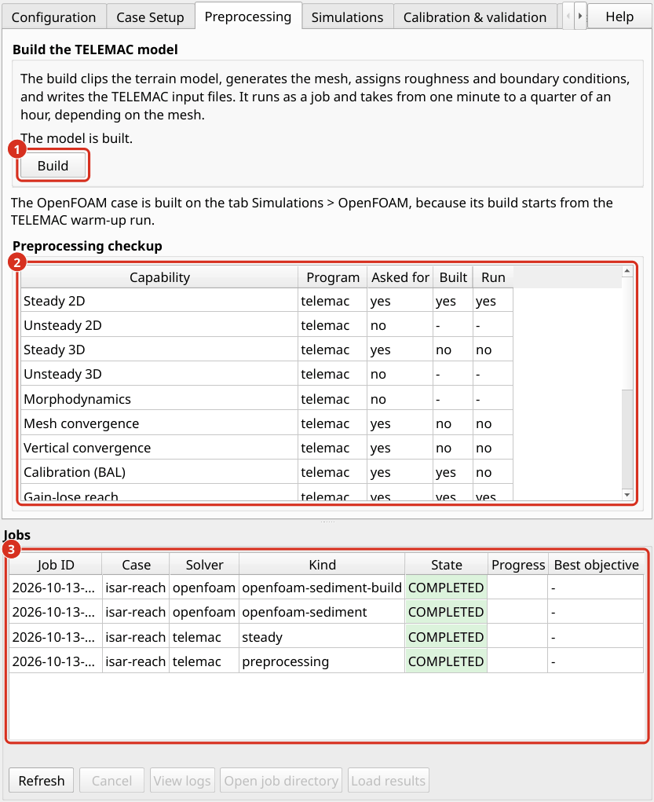

.. _help-preprocessing:

Preprocessing
=============

Preprocessing converts the case description into the files that a simulation code reads. No simulation is started during preprocessing. Its result is a complete model that can be inspected before computing time is spent.

.. _preprocessing-workflow:

aXqua workflow
--------------

aXqua builds a model in five steps, each of which uses the result of the previous one:

#. **Terrain.** The digital elevation model is converted to the coordinate reference system of the case and cut to the region of interest.
#. **Mesh.** The region of interest is divided into triangles according to the mesh zones, and each mesh node receives its bed elevation from the terrain model and its roughness zone.
#. **Boundaries.** The nodes on the outline of the mesh are compared with the inflow and outflow lines. Nodes on a line become open boundaries, and all other outline nodes become closed walls.
#. **Simulation settings.** The control file of TELEMAC (the steering file) and the roughness table are written from the settings of the case file.
#. **Measurements.** The field measurements are compiled into the table that the calibration reads.

Because all files originate from one case file, they are consistent with each other. For example, the order of the boundary nodes in the boundary file always matches the mesh.

To start preprocessing in the plugin, select the case on the *Case Setup* tab and click *Build* on the *Preprocessing* tab. The table *Preprocessing checkup* on that tab then states for every simulation of the case whether the case file asks for it, whether it is built, and whether it has been run. In a terminal, the command is:

.. code-block:: text

   axqua <case-file>

   The *Preprocessing* tab. (1) *Build* starts the preprocessing as a job. (2) The table *Preprocessing checkup* of the active case. (3) The job list, which is visible below every tab.

The model is written to the folder ``axqua-case/simulation/``. It consists of the mesh with bed elevations (``geometry.slf``), the boundary conditions (``boundaries.cli``), the roughness table (``friction.tbl``) and the steering file (``steady2d.cas``). The log file ``axqua.log`` in the same folder records every step with its duration.

.. _preprocessing-meshing:

Meshing
-------

The mesh is created **once** and then reused by all subsequent TELEMAC simulations of the case, including simulations with a varying discharge and 3D simulations, which use the same mesh in plan view. The only exception is the mesh convergence study, which deliberately creates several meshes of different resolution (:doc:`mesh-convergence`).

Two properties of the mesh generation are relevant in practice:

* The edge lengths in the mesh zones are target values. The realized triangles deviate slightly from them, in particular at the transition between the channel and the floodplain, where the triangle size changes gradually.
* Two builds from identical inputs produce slightly different meshes, with differences of less than 1 % in the number of nodes. Both meshes are valid. A result should therefore always be reported together with the mesh on which it was computed, and the mesh file should be kept.

After meshing, aXqua assesses the mesh and writes a quality report into the log file. The report lists the angles and the elongation of the triangles, the size ratio of neighboring triangles and the **shortest edge**. The shortest edge matters most, because it limits the time step of the simulation: one very small triangle can slow down the entire computation.

OpenFOAM requires a three-dimensional mesh. aXqua derives it from the same region of interest in a separate step (:ref:`preprocessing-openfoam-choices`).

.. _preprocessing-checkup:

Pre-processing checkup
----------------------

Three checks show whether a case is complete and plausible before a simulation is started.

**Check the inputs before building.** The following command reads the case file, verifies that all input files exist and that TELEMAC can be reached, and then stops. It takes about one second.

.. code-block:: text

   axqua <case-file> --check

**Check what has been built.** aXqua reports for each code and each type of simulation whether it is available, whether the case requests it, and whether its files exist:

.. code-block:: text

   axqua status <case-file>

.. list-table::
   :header-rows: 1
   :widths: 20 80

   * - Column
     - Meaning
   * - ``implemented``
     - aXqua offers this type of simulation for this code (``yes``, ``no``, or ``n/a`` when the type does not exist for the code).
   * - ``configured``
     - The case file requests this type of simulation.
   * - ``built``
     - The input files of the simulation exist.
   * - ``run``
     - A result file exists.

The plugin uses the same information to enable and disable its tabs and buttons. aXqua also stores it in two text files in the case folder, whose names state whether the case uses a code (for example ``MODEL=TELEMAC_ENABLED`` and ``MODEL=OPENFOAM_DISABLED``).

**Read the log file of the build.** Verify three items in ``axqua-case/simulation/axqua.log``:

* the mesh quality report contains no warnings for the floodplain and a plausible shortest edge;
* nodes were assigned to every inflow and outflow line. A warning appears when the node spacing at the inflow and at the outflow differs by more than 10 %, which may cause an unstable simulation;
* the measurement points lie inside the model. The command ``axqua check-gt <case-file>`` additionally compares the elevations of the measurement points with the terrain model.

The final check is the first simulation itself, which shows whether inflow and outflow reach a balance (:ref:`hydraulics-dry-runs`).

.. _preprocessing-telemac-choices:

TELEMAC choices
---------------

Two choices of the ``hydrodynamics`` block affect how TELEMAC solves the flow equations. Both have defaults that are suited for most rivers, lakes and reservoirs.

**Numerical method.** By default, TELEMAC uses finite elements. With ``finite_volumes: true``, it uses finite volumes instead, which is more robust for flows that change between subcritical and supercritical conditions, for example at a hydraulic jump. The finite volume method only supports a constant turbulent viscosity.

**Turbulence model.** With ``turbulence_model: auto``, aXqua compares the cell size in the channel with the water depth and selects the model that suits the mesh: a large eddy simulation model (Smagorinsky) on fine meshes, the k-epsilon model on meshes of intermediate resolution, and the Spalart-Allmaras model on coarse meshes. A number selects a particular TELEMAC model instead.

**Exchange with a porous body.** Some rivers lose water into a gravel bar and regain it further downstream. A depth-averaged model has no subsurface flow, so that aXqua represents this exchange by withdrawing water where it infiltrates and adding the same amount where it returns. The ``gain_lose`` block activates this function. ``zone`` names a polygon layer of the porous body, and ``conductivity`` is its hydraulic conductivity in m/s. Without this block, aXqua models no exchange, also if the liquid boundary layer contains internal exchange lines (``int-...``). The build log then names these lines.

.. code-block:: yaml

   gain_lose:
     enabled: true
     zone: user-sources/geodata/porous-body.gpkg
     conductivity: 3.0e-4

The locations of infiltration and return follow from the water levels of the channel at both ends of the porous body and therefore do not have to be drawn. The hydraulic conductivity of a riverbed varies over several orders of magnitude and should be calibrated (:doc:`calibration-validation`).

Structures that are never overtopped, such as walls and buildings, are represented in the TELEMAC model by a raised bed: aXqua lifts the bed at such structures to the crest elevation plus 2 m (``structures.solid_freeboard_2d``). With ``structures.solid_mode: cut``, their footprint is removed from the mesh instead.

.. _preprocessing-openfoam-choices:

OpenFOAM choices
----------------

The ``openfoam`` block activates and controls the three-dimensional model. Its mesh consists of columns of box-shaped cells that follow the riverbed at the bottom. The top of the mesh, which is called the lid, lies shortly above the water surface of the TELEMAC warm-up (:ref:`warm-up-concept`), so that the mesh contains little air.

.. code-block:: yaml

   openfoam:
     mode: vof              # vof | rigid-lid
     cell_size: 0.5         # [m] horizontal cell size
     n_layers: 14           # number of cells over the height
     n_processors: 16
     end_time: 300          # [s] simulated time

``mode`` is the most important choice:

``vof`` (volume of fluid)
    Water and air are both simulated, and the position of the water surface is a result. This mode answers questions about the shape of the water surface, for example at a weir or in a bend. It is the most expensive type of simulation in aXqua.
``rigid-lid``
    The lid is placed exactly on the water surface of the TELEMAC warm-up, and only water is simulated. The water surface cannot move. A coarse run of this type takes minutes where a ``vof`` run takes hours to days. It is suited for detecting errors in the mesh, the boundaries and the roughness before a ``vof`` run is started. It is not applicable where the water surface drops in steps, for example in a fish pass with pools. aXqua detects this situation and refuses to build such a model.

Instead of ``cell_size``, the entry ``cell_size_factor`` sets the horizontal cell size as a multiple of the channel edge length of the TELEMAC mesh. To obtain the number of cells without building the model, use:

.. code-block:: text

   axqua openfoam <case-file> --check

To build the OpenFOAM model in the plugin, click *Build* in the box *Free surface (VOF)* on the sub-tab *OpenFOAM* of the tab *Simulations*. The build reports the time step that the simulation will use and the resulting number of time steps, which indicates the computing time. The TELEMAC warm-up is active by default (``openfoam.pre_run.enabled``). With ``openfoam.pre_run.dimension: 3d``, the warm-up continues with a TELEMAC-3D run, so that the OpenFOAM model also starts with a vertical velocity distribution. This option requires a water depth of several horizontal cell sizes and is skipped with a message in shallow reaches.

**Inflow and outflow.** The OpenFOAM model takes the water in and out at the same lines as the TELEMAC model. At each inflow line, the discharge of that line enters the model, and the water level there is a result of the flow. At the outflow, the model holds the water level that the TELEMAC model prescribes there (``boundaries.outflow_condition``), or ``openfoam.outlet_stage`` where the case sets one. Above this level plus ``outlet_air_margin`` (0.25 m by default), the outflow is a closed wall, so that air enters and leaves the model only through its top. An outflow that is open over its whole height lets air circulate through the model, which in a fish pass finally drew water back in through the outflow. On the Isar example with 2 m cells, the wall changed the water levels at the inflows and the outflow by 2 mm at most, and the flow velocity in the columns of the mesh no more than it varies within one run over 100 s.

**Outflow with a stage-discharge relation.** By default, the outflow holds one water level for the whole run, the level that the outflow condition gives at the discharge of the case. With ``openfoam.outflow_boundary: rating-curve``, the outflow follows a stage-discharge relation instead: at every time step, it holds the water level that the relation gives for the discharge that actually leaves the model. This is the boundary condition ``waterLevel_alpha_prgh`` of the Federal Waterways Engineering and Research Institute (BAW; `Thorenz 2024 <https://doi.org/10.3929/ethz-b-000675949>`_), which the OpenFOAM installation of aXqua builds (:ref:`install-openfoam`). The relation is the table ``boundaries.stage_discharge`` where it has at least two discharges. Otherwise, aXqua derives one from the terrain at the outflow line with ``boundaries.rating_method``, for nine discharges between 0.1 and 3 times the discharge of the case, and writes it as ``rating-curve-openfoam.csv`` into the folder of the OpenFOAM model; the boundary condition does not extrapolate beyond the table. The run starts at the level of the relation at the discharge of the case, and the outflow is walled from ``outlet_air_margin`` above that level. The option requires a free surface (``mode: vof``) and cannot be combined with ``outlet_stage``. Where a model has several outflow lines, each follows the same relation with its own discharge. In the case settings, the option is *Outflow boundary* on the page *OpenFOAM*. On the Isar example with cells of 2.7 m, the case was built with the relation of the cross section at the outflow, and interFoam loaded the boundary condition and ran through both stages.

**Computing time.** The time step of a ``vof`` run is chosen by OpenFOAM from two limits: the Courant number at the water surface (``max_courant``, 0.9 by default) and the Courant number of the flow in all cells, which is the same number unless ``max_flow_courant`` sets a larger one. In a shallow river, the cells that reach the second limit first are air cells next to the waterline, where the cells are a few centimeters thick. Air needs no accuracy, so a value of 3 is reasonable; the water surface keeps its own limit. Each time step solves the pressure several times. ``pressure_correctors`` (3 by default) and ``non_orthogonal_correctors`` (2 by default) set how often, and values of 2 and 1 reduce the cost of a step by about 40 %. The following settings were used for the Isar example and gave the same result as the defaults in a comparison over 40 s of simulated time:

.. code-block:: yaml

   openfoam:
     max_courant: 0.9
     max_flow_courant: 3.0
     pressure_correctors: 2
     non_orthogonal_correctors: 1

**Sharpness of the water surface.** In a shallow river, the water surface of a ``vof`` run spreads over several cells. The layers of the mesh follow the bed, and the surface crosses them wherever the bed slopes. On the Isar example with 1 m cells and 14 layers, about a third of the water was in completely filled cells, and the transition from water to air was about as high as the water was deep. The setting ``interface_compression`` (1 by default) sets how strongly OpenFOAM keeps the surface together. With 2, the transition on the Isar example was half as high with 2 m cells and a quarter as high with 1 m cells, and the run needed about a third more time steps. With 1 m cells, the averages over the reach hardly changed: where the water was deeper than 5 cm, the water depth changed by 3 mm and the depth-averaged velocity by less than 0.01 m/s on average, and the water levels at the inflows and the outflow changed by less than 5 mm. Column by column, however, the depth-averaged velocity changed by 0.09 m/s (root mean square), five times as much as it varied within one run over 100 s, and the mean bed shear stress rose from 8.7 to 9.7 Pa. Local velocities and bed shear stresses of a ``vof`` run in a shallow reach thus depend on this setting; which value gives the more accurate ones has not been tested against measurements. Traces of water in a smeared surface also leave the model with the air through its top. aXqua reports this loss after each run as a share of the discharge and includes it in the discharge balance. On the Isar example with 1 m cells, the loss was 0.8 % of the discharge with compression 1 and 1.3 to 1.6 % with compression 2.

The simulated time a model needs to reach a steady state depends on how much water the reach has to store or release before inflow and outflow agree. A 3D model has a different resistance than the 2D model it starts from, and the difference in stored water drains slowly through pools and side channels. On the Isar example, the model with 2 m cells needed about 3000 s of simulated time until the outflow exceeded the inflow by less than 1 %.

